# ☁️ Cloud Computing for DevOps — AWS, Azure & GCP from A to Z

A complete, hands-on cloud course for DevOps interns who want to become confident cloud engineers.
Every topic has a **diagram**, a **plain-English explanation**, **why DevOps people care**, and **commands you can run right now**.
All sample code lives in [`examples/`](examples/).

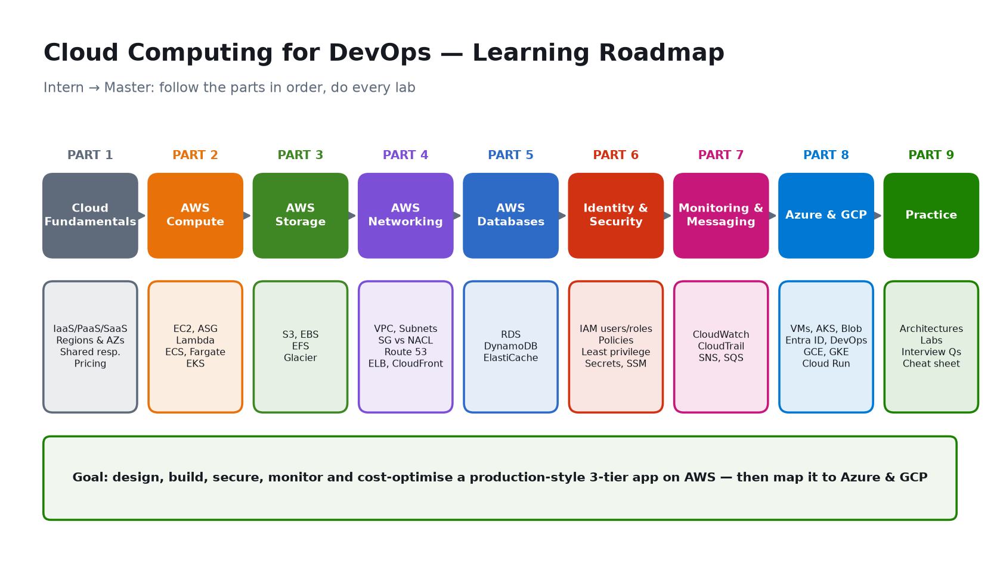

> 💡 **How to use this course:** read one section a day, run every **Try it now** block, and do the labs.
> Reading alone will not make you a cloud engineer. Building and breaking things will.

> ⚠ **Money warning:** cloud resources cost real money. Before anything else, do [Lab 0](#7-lab-0-set-up-your-aws-account-safely)
> (budget alert + MFA), and always run the **cleanup** step at the end of every lab.

---

## 📚 Table of Contents

**PART 1: Cloud Fundamentals**

1. [What is Cloud Computing](#1-what-is-cloud-computing)
2. [Service Models: IaaS, PaaS, SaaS](#2-service-models-iaas-paas-saas)
3. [Deployment Models: Public, Private, Hybrid, Multi-cloud](#3-deployment-models-public-private-hybrid-multi-cloud)
4. [Regions, Availability Zones and Edge Locations](#4-regions-availability-zones-and-edge-locations)
5. [The Shared Responsibility Model](#5-the-shared-responsibility-model)
6. [Pricing Models and Cost Basics](#6-pricing-models-and-cost-basics)
7. [Lab 0: Set Up Your AWS Account Safely](#7-lab-0-set-up-your-aws-account-safely)

**PART 2: AWS Compute**

8. [EC2 — Virtual Servers](#8-ec2--virtual-servers)
9. [Auto Scaling Groups](#9-auto-scaling-groups)
10. [Lambda — Serverless Functions](#10-lambda--serverless-functions)
11. [ECS and Fargate — Containers](#11-ecs-and-fargate--containers)
12. [EKS — Managed Kubernetes](#12-eks--managed-kubernetes)
13. [Choosing the Right Compute Service](#13-choosing-the-right-compute-service)

**PART 3: AWS Storage**

14. [S3 — Object Storage](#14-s3--object-storage)
15. [EBS — Block Storage for EC2](#15-ebs--block-storage-for-ec2)
16. [EFS — Shared File Storage](#16-efs--shared-file-storage)
17. [Glacier — Archive Storage](#17-glacier--archive-storage)

**PART 4: AWS Networking**

18. [VPC and Subnets](#18-vpc-and-subnets)
19. [Route Tables, Internet Gateway, NAT and Endpoints](#19-route-tables-internet-gateway-nat-and-endpoints)
20. [Security Groups vs Network ACLs](#20-security-groups-vs-network-acls)
21. [Route 53 — DNS](#21-route-53--dns)
22. [Elastic Load Balancing — ALB, NLB](#22-elastic-load-balancing--alb-nlb)
23. [CloudFront — CDN](#23-cloudfront--cdn)

**PART 5: AWS Databases**

24. [RDS — Managed Relational Databases](#24-rds--managed-relational-databases)
25. [DynamoDB — NoSQL](#25-dynamodb--nosql)
26. [ElastiCache — In-Memory Cache](#26-elasticache--in-memory-cache)
27. [Choosing the Right Database](#27-choosing-the-right-database)

**PART 6: Identity and Security**

28. [IAM — Users, Groups, Roles](#28-iam--users-groups-roles)
29. [IAM Policies and Least Privilege](#29-iam-policies-and-least-privilege)
30. [Secrets Manager and Systems Manager](#30-secrets-manager-and-systems-manager)

**PART 7: Monitoring and Messaging**

31. [CloudWatch and CloudTrail](#31-cloudwatch-and-cloudtrail)
32. [SNS and SQS](#32-sns-and-sqs)

**PART 8: Azure and GCP Equivalents**

33. [AWS to Azure to GCP Service Map](#33-aws-to-azure-to-gcp-service-map)
34. [Microsoft Azure Essentials](#34-microsoft-azure-essentials)
35. [Google Cloud Essentials](#35-google-cloud-essentials)

**PART 9: Putting It All Together**

36. [Reference Architecture: 3-Tier Web App](#36-reference-architecture-3-tier-web-app)
37. [DevOps on the Cloud: IaC and CI/CD](#37-devops-on-the-cloud-iac-and-cicd)
38. [Hands-on Labs](#38-hands-on-labs)
39. [Interview Questions](#39-interview-questions)
40. [Cheat Sheet](#40-cheat-sheet)
41. [What's in This Repo](#41-whats-in-this-repo)

---

# PART 1: Cloud Fundamentals

## 1. What is Cloud Computing

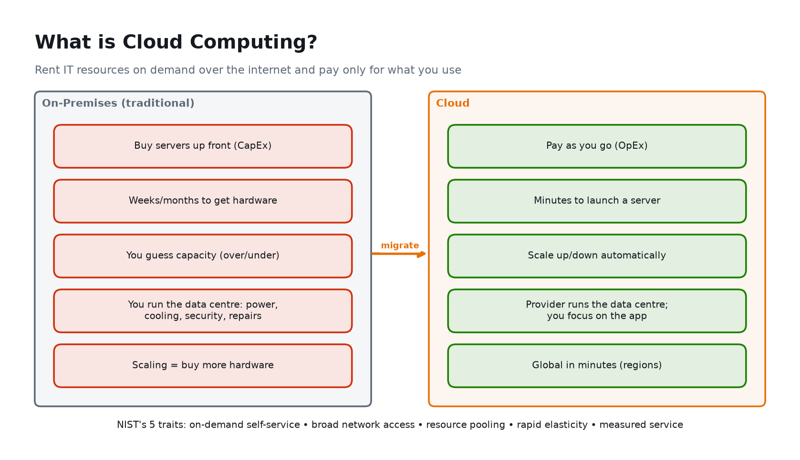

**What it is:** Renting computing resources (servers, storage, databases, networking, software) **on demand over the internet**, and paying only for what you use — instead of buying and running your own hardware.

**Why DevOps people care:** The cloud turns infrastructure into **API calls**. That means infrastructure can be versioned in Git, reviewed in pull requests, tested, and deployed by pipelines — exactly what DevOps is about.

### 1.1 The 5 essential characteristics (NIST definition)

| Characteristic | Meaning | Example |
|---|---|---|
| On-demand self-service | Get resources yourself, no ticket to IT | Launch an EC2 server from the console in 1 minute |
| Broad network access | Reach it from anywhere over the network | Manage AWS from a laptop, phone, or CI runner |
| Resource pooling | Provider shares big hardware between many customers | Your VM runs on a host shared with other tenants (isolated) |
| Rapid elasticity | Scale out/in quickly, often automatically | Auto Scaling adds 10 servers during a sale |
| Measured service | You pay for what you use, metered | EC2 billed per second, S3 per GB-month |

### 1.2 Why companies move to the cloud

| Benefit | What it really means |
|---|---|
| **CapEx → OpEx** | No big upfront hardware purchase; a monthly bill instead |
| **Speed / agility** | New environment in minutes, not months |
| **Elasticity** | Stop guessing capacity; scale with demand |
| **Global reach** | Deploy close to users in many countries |
| **Economies of scale** | AWS buys hardware cheaper than you can |
| **Focus** | Spend time on the product, not on data-centre cooling |

### 1.3 Key vocabulary

| Term | Meaning |
|---|---|
| **High availability (HA)** | System keeps working when a component fails (e.g. run in 2+ AZs) |
| **Fault tolerance** | Zero interruption even during a failure (more expensive than HA) |
| **Scalability** | Ability to handle more load. **Vertical** = bigger machine; **Horizontal** = more machines |
| **Elasticity** | Scaling **automatically** up AND down with demand |
| **Durability** | Data is not lost (S3: 99.999999999% — "11 nines") |
| **Disaster recovery (DR)** | Recovering from a big failure (region outage). Measured by **RTO** (how long to recover) and **RPO** (how much data you can lose) |

> 💡 **Tip:** In interviews, "scalable" and "elastic" are not the same thing. Scalable = *can* grow. Elastic = grows and shrinks *automatically*.

---

## 2. Service Models: IaaS, PaaS, SaaS

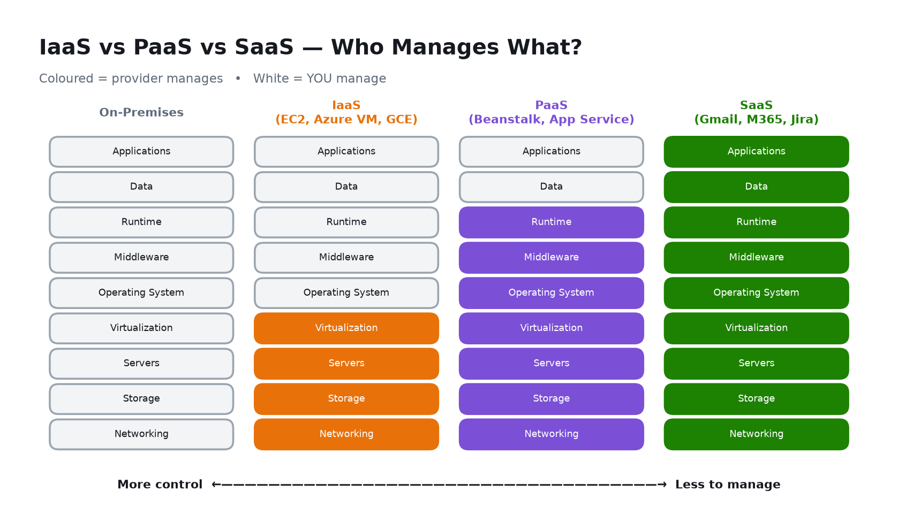

**What it is:** How much of the stack the provider manages for you.

**Why DevOps people care:** The model decides **who patches what, who gets paged at 3 a.m., and how much control you have**. Picking the right level is a core architecture skill.

| Model | You manage | Provider manages | AWS examples | Azure | GCP |
|---|---|---|---|---|---|
| **IaaS** (Infrastructure) | OS, runtime, app, data | Hardware, network, virtualization | EC2, EBS, VPC | Virtual Machines | Compute Engine |
| **PaaS** (Platform) | App code + data | Everything else incl. OS and runtime | Elastic Beanstalk, RDS, App Runner | App Service | App Engine, Cloud Run |
| **SaaS** (Software) | Just your data/users | Everything | WorkMail, QuickSight | Microsoft 365 | Google Workspace |
| **FaaS / Serverless** | Function code | Servers, scaling, runtime | Lambda | Azure Functions | Cloud Run functions |
| **CaaS** (Containers) | Containers | Orchestration platform | ECS, EKS, Fargate | AKS, Container Apps | GKE |

> 💡 **Pizza analogy:** On-prem = make pizza at home. IaaS = buy a ready base and cook it yourself. PaaS = pizza delivery. SaaS = eat at the restaurant.

---

## 3. Deployment Models: Public, Private, Hybrid, Multi-cloud

| Model | What it is | When to use |
|---|---|---|
| **Public cloud** | Shared provider infrastructure (AWS, Azure, GCP) | Default choice for most new workloads |
| **Private cloud** | Cloud-style platform used by one organisation (e.g. OpenStack, VMware) | Strict regulation, existing data centre investment |
| **Hybrid cloud** | On-prem + public cloud connected (VPN / Direct Connect) | Gradual migration, data that must stay on-site |
| **Multi-cloud** | Using 2+ public clouds | Best-of-breed services, avoiding lock-in, acquisitions |

> ⚠ **Warning:** Multi-cloud sounds great but doubles the skills, tooling and security work. Most teams should master **one** cloud first.

---

## 4. Regions, Availability Zones and Edge Locations

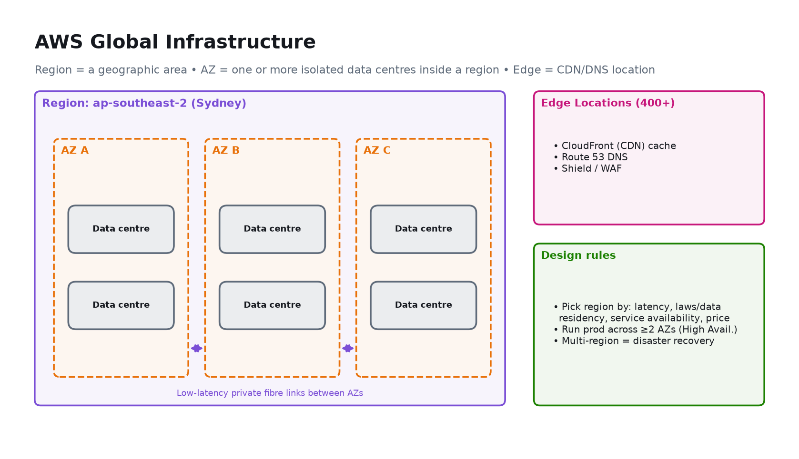

**What it is:**

- **Region** — a geographic area (e.g. `ap-southeast-2` Sydney, `us-east-1` N. Virginia). Regions are **independent** of each other.
- **Availability Zone (AZ)** — one or more physically separate data centres inside a region, with independent power and networking, connected by low-latency links. Named like `ap-southeast-2a`.
- **Edge location** — smaller sites in many cities used by CloudFront (CDN), Route 53 (DNS) and AWS Shield/WAF.
- **Local Zones / Wavelength / Outposts** — AWS infrastructure even closer to users or inside your own data centre.

**Why DevOps people care:** HA design starts here. **One AZ = single point of failure.** Production should run in **at least 2 AZs**; critical systems may plan for **multi-region** DR.

### 4.1 How to choose a region

| Factor | Question to ask |
|---|---|
| **Compliance / data residency** | Must the data stay in this country? |
| **Latency** | Where are my users? |
| **Service availability** | Is the service I need available there? (new services launch in `us-east-1` first) |
| **Price** | Prices differ by region |

### 4.2 Global vs regional vs zonal services

| Scope | Examples |
|---|---|
| **Global** | IAM, Route 53, CloudFront, WAF (for CloudFront) |
| **Regional** | S3 (bucket lives in a region), DynamoDB, Lambda, VPC, SQS, SNS |
| **Zonal (per AZ)** | EC2 instance, EBS volume, subnet |

### Try it now

```bash
aws ec2 describe-regions --query "Regions[].RegionName" --output table
aws ec2 describe-availability-zones --region ap-southeast-2 \
  --query "AvailabilityZones[].{Name:ZoneName,Id:ZoneId,State:State}" --output table
```

> 💡 **Tip:** AZ *names* (`us-east-1a`) are shuffled per account. The AZ **ID** (`use1-az1`) is the real physical zone — use IDs when coordinating across accounts.

---

## 5. The Shared Responsibility Model

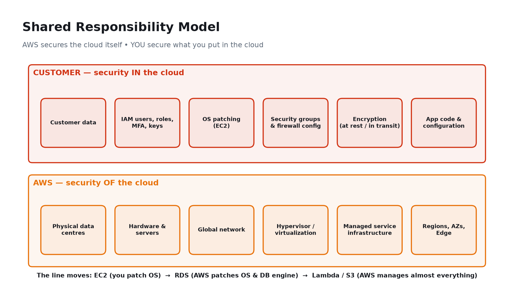

**What it is:** Security is split. **AWS is responsible for security *of* the cloud** (buildings, hardware, hypervisor, global network). **You are responsible for security *in* the cloud** (your data, IAM, OS patching on EC2, security groups, encryption settings, app code).

**Why DevOps people care:** Almost every cloud breach in the news is a **customer-side** mistake: a public S3 bucket, leaked access keys, an open security group, unpatched servers.

| Service type | Example | Who patches the OS? | You still own |
|---|---|---|---|
| IaaS | EC2 | **You** | OS, firewall, app, data, IAM |
| Managed container | ECS on Fargate | AWS | Container image, task role, data |
| Managed DB | RDS | AWS | DB users, network access, encryption choice, backups retention |
| Serverless | Lambda, S3, DynamoDB | AWS | Code, IAM permissions, data, bucket policies |

> 💡 **Remember:** You can **never** outsource responsibility for your **data** and your **IAM permissions**.

---

## 6. Pricing Models and Cost Basics

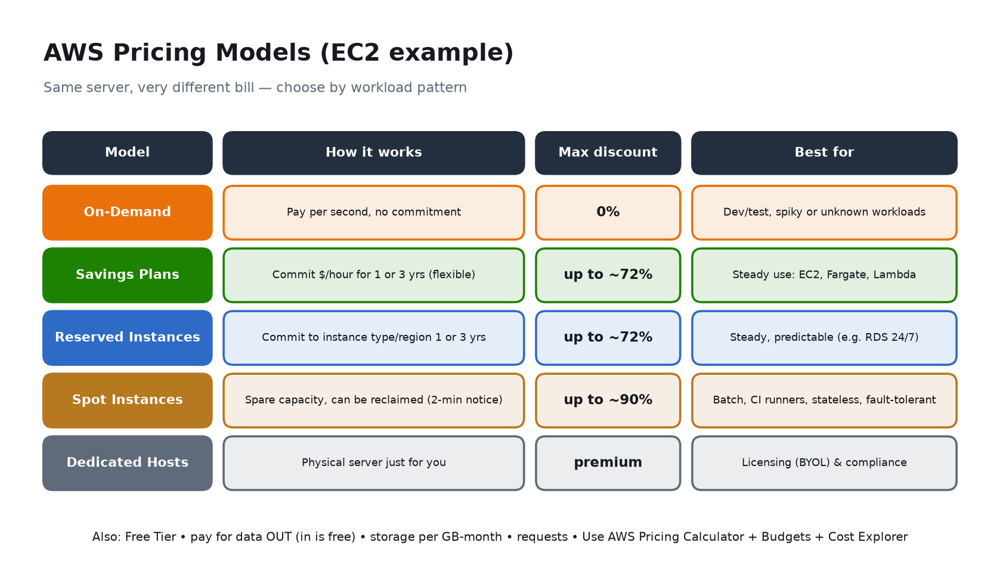

**What it is:** The ways you can pay for compute, plus the basic things AWS charges for.

**Why DevOps people care:** In many companies the DevOps team owns the cloud bill. **FinOps** (cloud cost management) is a real skill that interviewers ask about.

### 6.1 Compute purchase options

| Option | Commitment | Typical saving | Good for |
|---|---|---|---|
| **On-Demand** | None | — | Dev/test, unpredictable or short workloads |
| **Savings Plans** | $/hour for 1 or 3 years | up to ~72% | Steady usage. Compute Savings Plans also cover Fargate and Lambda |
| **Reserved Instances** | Specific instance family/region, 1 or 3 years | up to ~72% | Steady, predictable (RDS, ElastiCache, OpenSearch also have reservations) |
| **Spot Instances** | None, but AWS can reclaim with **2-minute warning** | up to ~90% | CI runners, batch jobs, stateless workers, big data |
| **Dedicated Hosts / Instances** | Physical isolation | Costs more | Licences tied to physical cores, compliance |

### 6.2 What actually costs money

| You pay for | Notes |
|---|---|
| **Compute time** | EC2 per second (Linux, 60 s minimum), Lambda per ms + requests |
| **Storage** | Per GB-month (S3, EBS — even when the EC2 is stopped!) |
| **Data transfer OUT** | Data **into** AWS is free. Out to the internet and **between AZs/regions** costs |
| **Requests / API calls** | S3 GET/PUT, DynamoDB reads/writes, API Gateway |
| **Always-on managed resources** | NAT Gateway, load balancers, EKS control plane, idle RDS, public IPv4 addresses |

### 6.3 Cost tools

| Tool | Use it for |
|---|---|
| **AWS Pricing Calculator** | Estimate before you build |
| **AWS Budgets** | Alerts when spend crosses a limit (**set this up first!**) |
| **Cost Explorer** | See spend by service, tag, account |
| **Cost allocation tags** | Tag resources `Project`, `Env`, `Owner` to split the bill |
| **Compute Optimizer / Trusted Advisor** | Right-sizing and idle-resource recommendations |

> ⚠ **Top 5 surprise bills for beginners:** a forgotten **NAT Gateway**, an **EKS cluster** left running, a big **RDS** instance, **unattached Elastic IPs / EBS volumes**, and resources launched in the **wrong region** that you forgot about. Use [`examples/cost/find-forgotten-resources.sh`](examples/cost/find-forgotten-resources.sh).

---

## 7. Lab 0: Set Up Your AWS Account Safely

Do this **before any other lab**.

**Step 1 — Protect the root user**
1. Sign in as root (the email you signed up with).
2. Enable **MFA** on root (IAM → Security credentials → Assign MFA).
3. **Never** create access keys for root. Use root only for billing/account tasks.

**Step 2 — Create a budget alert** (Billing → Budgets → Create budget → "Monthly cost budget"), or run:

```bash
./examples/cost/budget.sh you@example.com 10      # alert at 80% and 100% (forecast) of $10/month
```

**Step 3 — Create your daily-use identity**
- Best: enable **IAM Identity Center** and create a user with the `AdministratorAccess` permission set (gives temporary credentials and a login portal).
- Simpler for a personal lab account: create an IAM user in an `Admins` group with MFA.

**Step 4 — Install and configure the AWS CLI v2**

```bash
aws --version                         # aws-cli/2.x
aws configure sso                     # if you use IAM Identity Center (recommended)
# or
aws configure                         # access key + secret for an IAM user (lab only)
aws sts get-caller-identity           # "who am I?" — run this whenever in doubt
```

```bash
# Useful CLI habits
export AWS_REGION=ap-southeast-2       # default region for this shell
export AWS_PROFILE=lab                 # which named profile to use
aws s3 ls --output table               # --output json | table | text
aws ec2 describe-instances --query "Reservations[].Instances[].InstanceId"   # --query uses JMESPath
```

> 💡 **Tip:** Pick **one** home region for all labs (this course uses `ap-southeast-2`, Sydney — change it to the one nearest you) so you never lose track of resources.

> ⚠ **Free Tier:** AWS changed the Free Tier for accounts created after 15 July 2025 to a credit-based free plan. Always check the current Free Tier page and your **Billing → Free Tier** usage.

---

# PART 2: AWS Compute

## 8. EC2 — Virtual Servers

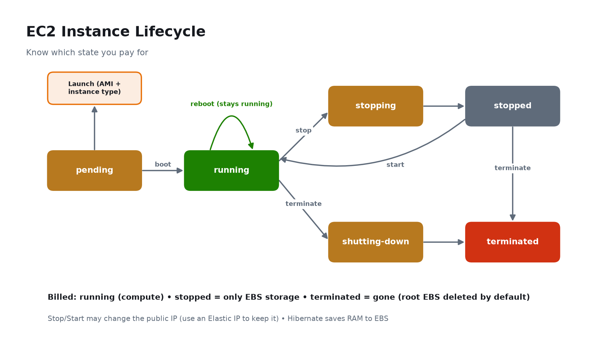

**What it is:** Elastic Compute Cloud — virtual machines in the cloud. You choose the OS image (AMI), size (instance type), network, storage and security.

**Why DevOps people care:** EC2 is the foundation under almost everything (ECS on EC2, EKS nodes, CI runners, bastion hosts, legacy apps). You must know how to launch, bootstrap, secure and troubleshoot it.

### 8.1 Key building blocks

| Piece | What it is |
|---|---|
| **AMI** (Amazon Machine Image) | The template: OS + preinstalled software. Get latest IDs from SSM public parameters, never hard-code |
| **Instance type** | CPU/RAM/network size, e.g. `t3.micro`, `m7g.large` |
| **Key pair** | SSH key for login (prefer **SSM Session Manager** — no key, no port 22) |
| **Security group** | Instance-level firewall |
| **EBS volume** | The disk (root + extra volumes) |
| **User data** | Script that runs **once on first boot** — install packages, configure app |
| **Instance profile** | Attaches an **IAM role** so code on the instance gets temporary AWS credentials |
| **Instance metadata (IMDS)** | `169.254.169.254` — the instance asks "who am I?". Always require **IMDSv2** |
| **Elastic IP** | Static public IPv4 address (charged; release when not used) |
| **Placement group** | Control physical placement: cluster (low latency), spread (HA), partition (big data) |

### 8.2 Instance type naming

`m7g.large` → **m** = family (general purpose) · **7** = generation · **g** = Graviton (ARM) · **large** = size

| Family | Optimised for | Example use |
|---|---|---|
| **t** (t3, t4g) | Burstable, cheap | Dev, small web apps, labs |
| **m** | General purpose | Most app servers |
| **c** | Compute | CI builds, batch, gaming |
| **r / x** | Memory | Databases, caches, in-memory analytics |
| **i / d** | Storage (fast local NVMe) | NoSQL, data warehouses |
| **g / p / inf / trn** | GPU / ML accelerators | ML training and inference |

Suffixes: **g** = Graviton ARM (usually cheaper), **a** = AMD, **i** = Intel, **n** = more network, **d** = local NVMe disk.

### 8.3 Lifecycle and billing

| State | Billed for compute? | Notes |
|---|---|---|
| `pending` → `running` | Yes (when running) | |
| `stopped` | **No** | You still pay for EBS volumes and Elastic IPs |
| `terminated` | No | Root EBS deleted by default. **Gone forever** — use termination protection on important instances |
| Hibernate | No | RAM saved to encrypted EBS, fast resume |

### Try it now

```bash
cd examples/ec2
./launch-ec2.sh             # launches Amazon Linux 2023 + nginx, prints the URL
./launch-ec2.sh cleanup     # terminate + delete the security group
```

Look at [`examples/ec2/user-data.sh`](examples/ec2/user-data.sh): it installs nginx and uses **IMDSv2** to print the instance ID and AZ.

```bash
# Useful EC2 commands
aws ec2 describe-instances --filters Name=instance-state-name,Values=running \
  --query "Reservations[].Instances[].{Id:InstanceId,Type:InstanceType,AZ:Placement.AvailabilityZone,IP:PublicIpAddress}" \
  --output table
aws ec2 stop-instances --instance-ids i-0123456789abcdef0
aws ec2 get-console-output --instance-id i-0123456789abcdef0 --latest --output text   # debug boot problems
aws ssm start-session --target i-0123456789abcdef0                                       # shell without SSH
```

> 💡 **Troubleshooting "I can't reach my EC2 web server":** check in this order → instance **running** and status checks 2/2 → **public IP** exists → subnet route table has `0.0.0.0/0 → IGW` → **security group** allows the port from your IP → **NACL** allows it (both directions) → the app is actually listening (`ss -tlnp`).

---

## 9. Auto Scaling Groups

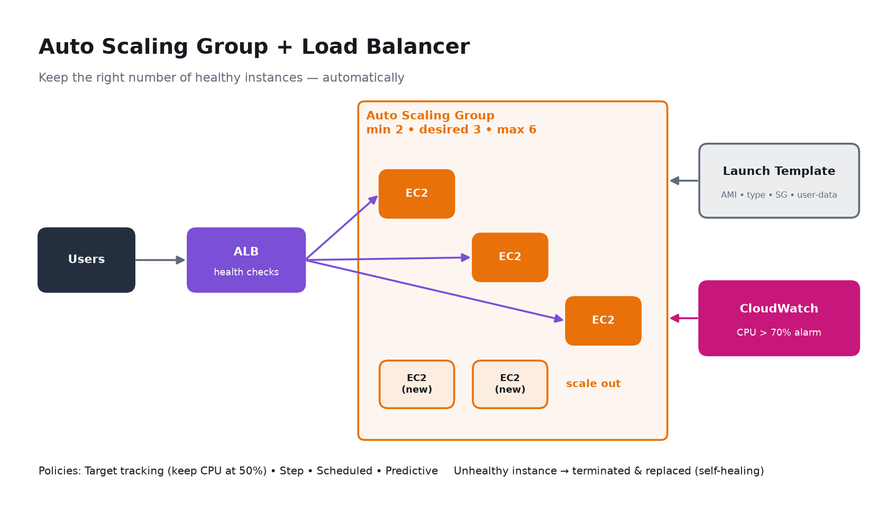

**What it is:** An **Auto Scaling Group (ASG)** keeps a fleet of EC2 instances at the right size: between a **min** and **max**, aiming for **desired** capacity. It replaces unhealthy instances automatically and spreads them across AZs.

**Why DevOps people care:** ASG gives you **self-healing** and **elasticity** for free. It is also how blue/green and rolling deployments work on plain EC2 (**instance refresh**).

| Concept | Meaning |
|---|---|
| **Launch template** | "How to build one instance": AMI, type, SG, IAM role, user data |
| **Min / desired / max** | Capacity limits. ASG always keeps `min ≤ running ≤ max` |
| **Health check type** | `EC2` (instance status) or `ELB` (load balancer health check — use this behind an ALB) |
| **Target tracking policy** | "Keep average CPU at 50%" — the simplest and best default |
| **Step / simple scaling** | Add N instances when an alarm fires |
| **Scheduled scaling** | Scale up every weekday 8 a.m. |
| **Predictive scaling** | ML forecasts daily/weekly patterns |
| **Instance refresh** | Rolling replacement of instances with a new launch template version |
| **Mixed instances + Spot** | Combine On-Demand base + cheap Spot capacity |
| **Lifecycle hooks** | Run actions while an instance launches/terminates (e.g. drain, copy logs) |
| **Warm pools** | Pre-initialised stopped instances for faster scale-out |

### Try it now

```bash
cd examples/autoscaling
# edit SG_ID and SUBNETS first
./create-asg.sh
# Self-healing demo: terminate one instance and watch the ASG launch a replacement
aws autoscaling describe-auto-scaling-instances --query "AutoScalingInstances[].[InstanceId,LifecycleState,HealthStatus]" --output table
aws ec2 terminate-instances --instance-ids <one-of-the-ids>
aws autoscaling describe-scaling-activities --auto-scaling-group-name lesson-web-asg --max-items 3
```

The full ALB + ASG setup in one template: [`examples/cloudformation/vpc-web.yaml`](examples/cloudformation/vpc-web.yaml).

> 💡 **Tip:** Design instances to be **stateless** (no important data on local disk; sessions in ElastiCache/DynamoDB; files in S3/EFS). Then any instance can be killed at any time — that is what makes scaling and Spot safe.

---

## 10. Lambda — Serverless Functions

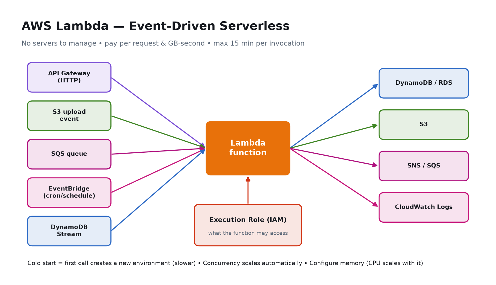

**What it is:** Run code **without managing servers**. You upload a function; AWS runs it when an **event** happens, scales it automatically, and bills per request and per millisecond of execution.

**Why DevOps people care:** Lambda is the glue of AWS automation: react to S3 uploads, process queues, run scheduled ops tasks (cleanup, backups, reports), respond to alarms, build lightweight APIs.

| Fact | Value |
|---|---|
| Max execution time | **15 minutes** |
| Memory | 128 MB – 10,240 MB (CPU scales with memory) |
| `/tmp` storage | 512 MB default, up to 10 GB |
| Runtimes | Python, Node.js, Java, .NET, Ruby, custom runtime, or **container image** (up to 10 GB) |
| Pricing | Per request + GB-seconds (generous free tier) |
| Permissions | **Execution role** (what the function can do) + **resource policy** (who can invoke it) |

| Invocation type | Example sources | Retry behaviour |
|---|---|---|
| **Synchronous** | API Gateway, ALB, SDK `invoke` | Caller handles errors |
| **Asynchronous** | S3, SNS, EventBridge | Lambda retries twice, then a DLQ / on-failure destination |
| **Poll-based (event source mapping)** | SQS, Kinesis, DynamoDB Streams | Lambda polls; failures retried/sent to DLQ |

**Key concepts:** **cold start** (first call creates a new environment — slower; reduce with smaller packages, or **Provisioned Concurrency** / SnapStart), **concurrency** (number of copies running at once; account limit per region), **layers** (shared libraries), **versions and aliases** (`prod` alias → version 7, for safe rollouts), **environment variables** (config, not secrets — read secrets from Secrets Manager).

### Try it now

```bash
cd examples/lambda
zip function.zip handler.py
# Create an execution role first (trust: lambda.amazonaws.com, policy: AWSLambdaBasicExecutionRole)
aws lambda create-function --function-name lesson-hello \
  --runtime python3.12 --handler handler.lambda_handler \
  --role arn:aws:iam::<ACCOUNT_ID>:role/lesson-lambda-role \
  --zip-file fileb://function.zip
aws lambda invoke --function-name lesson-hello --payload fileb://event-api.json out.json && cat out.json
aws lambda invoke --function-name lesson-hello --payload fileb://event-s3.json out.json && cat out.json
aws logs tail /aws/lambda/lesson-hello --follow          # see the logs live
# Cleanup
aws lambda delete-function --function-name lesson-hello
```

> 💡 **Tip:** Put SDK clients and config **outside** the handler — they are reused across warm invocations (faster and cheaper).

---

## 11. ECS and Fargate — Containers

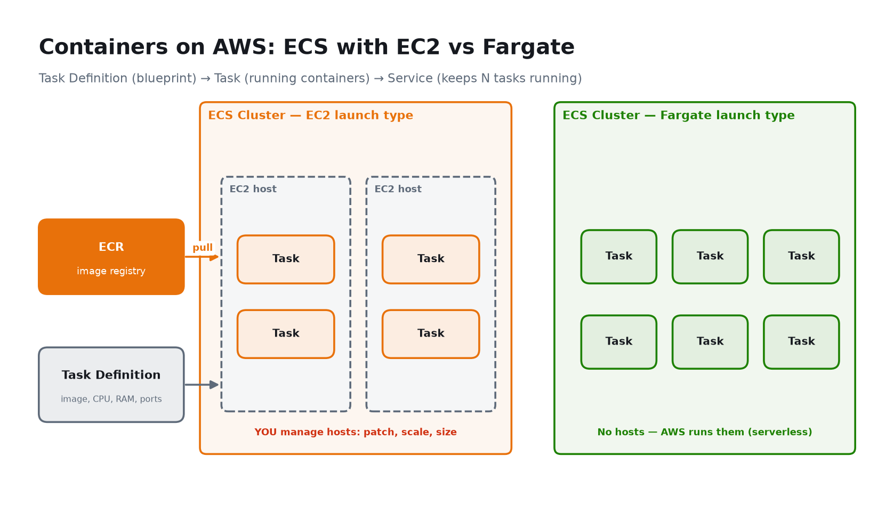

**What it is:** **ECS** (Elastic Container Service) is AWS's own container orchestrator. **Fargate** is a serverless **launch type**: AWS runs the containers and you never see a server. **ECR** is the private Docker image registry.

**Why DevOps people care:** "Containerise the app and run it on ECS Fargate" is one of the most common real-world DevOps projects: simpler than Kubernetes, no servers to patch.

| ECS term | Meaning | Kubernetes equivalent |
|---|---|---|
| **Cluster** | Logical group of capacity | Cluster |
| **Task definition** | Blueprint: image, CPU/RAM, ports, env vars, secrets, IAM roles, logging | Pod spec |
| **Task** | A running copy of a task definition | Pod |
| **Service** | Keeps N tasks running, registers with a load balancer, does rolling deploys | Deployment + Service |
| **Task role** | IAM permissions for **your app** | ServiceAccount + IRSA |
| **Task execution role** | Permissions for **ECS itself** (pull from ECR, write logs, read secrets) | — |
| **Capacity provider** | Where tasks run: Fargate, Fargate Spot, or an EC2 ASG | Node pools |

| | **ECS on EC2** | **ECS on Fargate** |
|---|---|---|
| Servers | You manage the EC2 hosts (patching, scaling, AMIs) | None — AWS manages |
| Pricing | Pay for the instances | Pay per task vCPU + memory per second |
| Control | GPUs, special instance types, daemon tasks | Less control, much less work |
| Best for | Large, steady fleets; cost-optimised bin-packing | Most teams; spiky or small workloads |

### Try it now

```bash
cd examples/ecs
./push-to-ecr.sh v1                   # build & push your image (needs a Dockerfile)
./deploy-fargate.sh                   # cluster + task definition + service on Fargate
```

See [`examples/ecs/task-definition.json`](examples/ecs/task-definition.json) for a production-style task definition: health check, CloudWatch logs, and a database password injected **from Secrets Manager** (never in plain env vars).

---

## 12. EKS — Managed Kubernetes

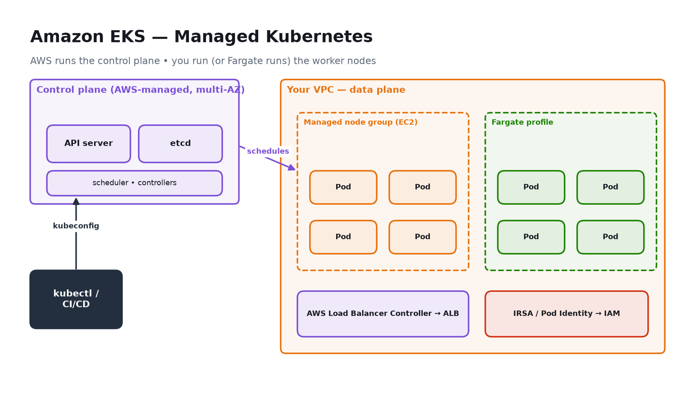

**What it is:** **EKS** runs the Kubernetes **control plane** (API server, etcd, scheduler) for you across multiple AZs. You provide the **data plane**: managed node groups (EC2), self-managed nodes, **Fargate** profiles, or **EKS Auto Mode** (AWS manages nodes too).

**Why DevOps people care:** Kubernetes is the industry standard for running containers at scale and is **portable across clouds** (EKS ↔ AKS ↔ GKE). Many DevOps job descriptions list it.

| AWS integration | What it does |
|---|---|
| **VPC CNI** | Pods get real VPC IP addresses |
| **AWS Load Balancer Controller** | `Ingress` → ALB, `Service type: LoadBalancer` → NLB |
| **IRSA / EKS Pod Identity** | Give an individual pod an IAM role (no node-wide credentials) |
| **EBS / EFS CSI drivers** | Persistent volumes |
| **Cluster Autoscaler / Karpenter** | Add/remove nodes based on pending pods |
| **Access entries** | Map IAM users/roles to Kubernetes RBAC |

### Try it now (costs money — delete when done!)

```bash
cd examples/eks
eksctl create cluster -f cluster.yaml            # ~15-20 min
kubectl get nodes -o wide
kubectl apply -f app.yaml                        # Deployment + LoadBalancer Service + HPA
kubectl get pods,svc,hpa -n lesson
kubectl -n lesson get svc web -o jsonpath='{.status.loadBalancer.ingress[0].hostname}'
# Cleanup (delete the Service first so the load balancer is removed)
kubectl delete -f app.yaml
eksctl delete cluster -f cluster.yaml
```

> ⚠ **Warning:** An EKS cluster costs about **$0.10/hour** for the control plane **plus** worker nodes, load balancers and NAT. Never leave a lab cluster running overnight.

---

## 13. Choosing the Right Compute Service

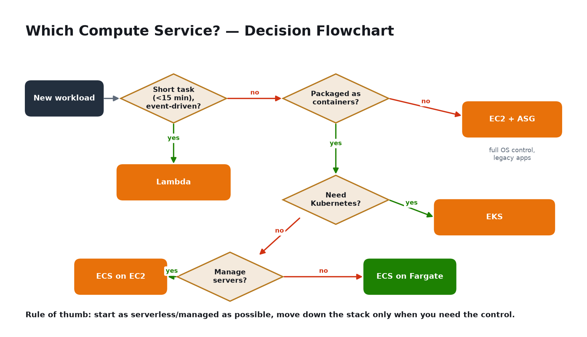

| Need | Pick |
|---|---|
| Event-driven, short (<15 min) tasks, glue code | **Lambda** |
| Containerised web app/API, small team, no K8s requirement | **ECS on Fargate** (or App Runner) |
| Kubernetes standard / portability / large platform team | **EKS** |
| Full OS control, legacy apps, special hardware, licences | **EC2 + ASG** |
| Batch jobs at scale | **AWS Batch** (EC2/Fargate/Spot underneath) |
| Simple PaaS for a classic web app | **Elastic Beanstalk** |

> 💡 **Rule of thumb:** go **as managed as possible**, move down to more control only when you have a concrete reason.

---

# PART 3: AWS Storage

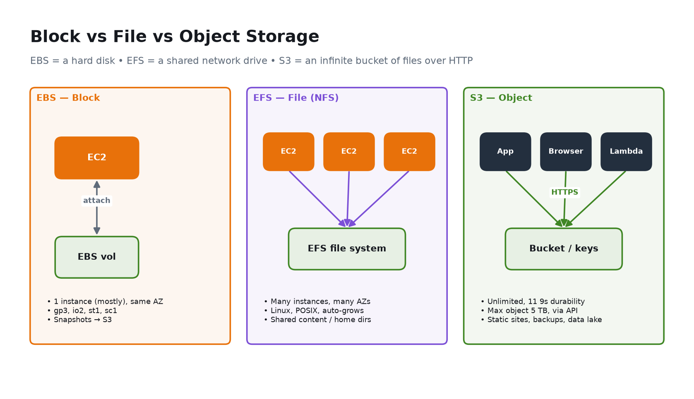

| | **S3** | **EBS** | **EFS** | **Glacier** (S3 classes) |
|---|---|---|---|---|
| Type | Object | Block | File (NFS) | Object archive |
| Access | HTTPS API from anywhere | Attached to **one** EC2 (same AZ) | Mounted by **many** EC2/containers across AZs | Via S3 API, restore before read (except Instant Retrieval) |
| Size limit | Unlimited (5 TB per object) | Up to 64 TiB per volume | Petabytes, grows automatically | Unlimited |
| Typical use | Backups, static websites, logs, data lake, artifacts | OS disk, databases on EC2 | Shared content, home dirs, CMS uploads | Compliance archives, long-term backups |

## 14. S3 — Object Storage

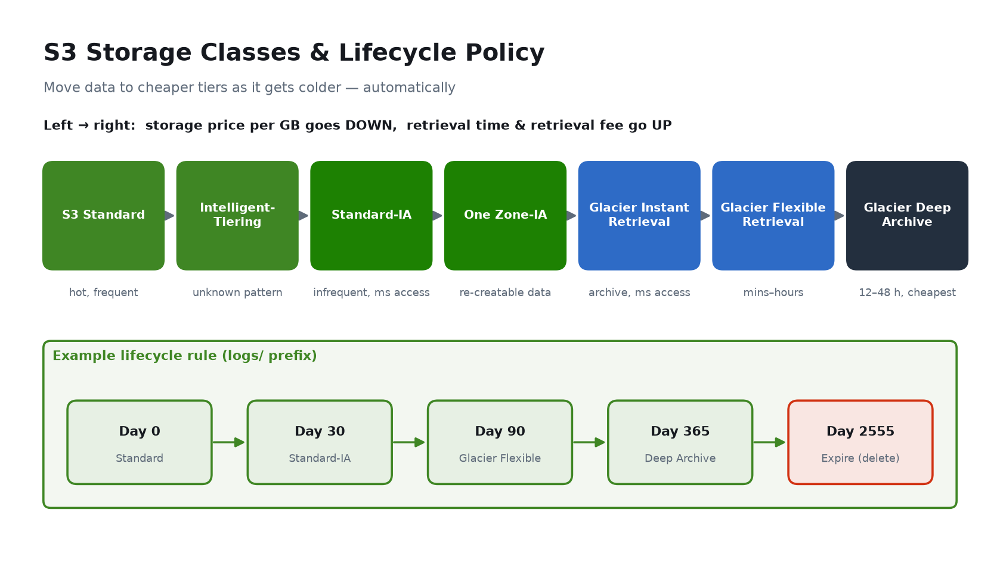

**What it is:** Simple Storage Service — store any amount of data as **objects** (file + metadata) inside **buckets**, addressed by a **key** like `logs/2026/11/20/app.log`. Designed for **99.999999999% durability**.

**Why DevOps people care:** S3 is everywhere in DevOps: Terraform state, build artifacts, logs, backups, static sites, CloudTrail logs, data lakes. It is also the #1 source of data leaks when misconfigured.

### 14.1 Core concepts

| Concept | Meaning |
|---|---|
| **Bucket** | Container for objects. Name is **globally unique**, bucket lives in one region |
| **Object / key** | The file and its full "path". Folders are only a key prefix illusion |
| **Versioning** | Keep every version; protects against overwrite/delete. Required for replication |
| **Storage classes** | Standard, Intelligent-Tiering, Standard-IA, One Zone-IA, Glacier Instant/Flexible/Deep Archive, Express One Zone |
| **Lifecycle rules** | Move objects to cheaper classes or delete them automatically |
| **Replication** | CRR (cross-region) / SRR (same-region) for DR and compliance |
| **Consistency** | Strong read-after-write consistency for all operations |
| **Presigned URL** | Temporary link to download/upload a private object |
| **Event notifications** | Trigger Lambda / SQS / SNS / EventBridge on upload or delete |
| **Static website hosting** | Serve HTML directly (better: private bucket + CloudFront) |

### 14.2 Storage classes

| Class | Retrieval | Min storage duration | Use for |
|---|---|---|---|
| **S3 Standard** | ms | — | Hot, frequently accessed data |
| **Intelligent-Tiering** | ms (archive tiers optional) | — | Unknown or changing access patterns |
| **Standard-IA** | ms (+ retrieval fee) | 30 days | Infrequent but needs fast access (backups) |
| **One Zone-IA** | ms (+ fee), **single AZ** | 30 days | Re-creatable data (thumbnails) |
| **Glacier Instant Retrieval** | ms (+ fee) | 90 days | Archives read about once a quarter |
| **Glacier Flexible Retrieval** | minutes to hours | 90 days | Archives, backups you rarely restore |
| **Glacier Deep Archive** | up to 12–48 hours | 180 days | Compliance data kept for years — cheapest |

### 14.3 Securing S3

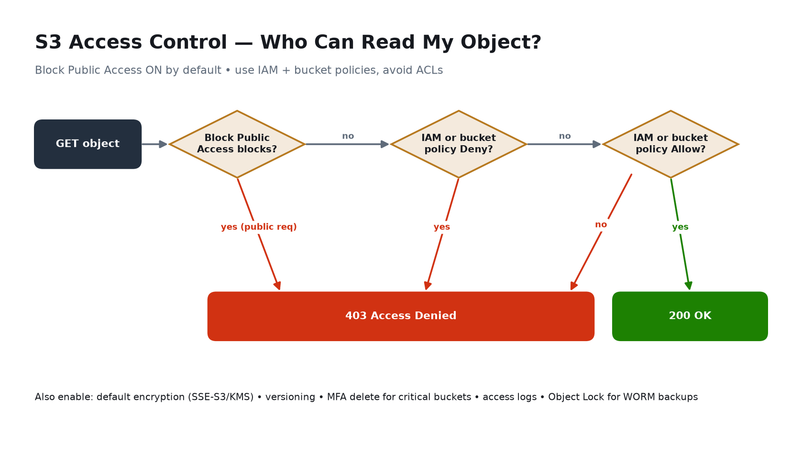

| Control | What to do |
|---|---|
| **Block Public Access** | Keep it **ON** (default for new buckets) at account and bucket level |
| **Bucket policy** | Resource-based JSON policy — e.g. deny non-HTTPS ([`bucket-policy-https-only.json`](examples/s3/bucket-policy-https-only.json)) |
| **IAM policies** | Grant users/roles only the buckets and prefixes they need |
| **Object Ownership** | "Bucket owner enforced" — disables ACLs (the modern default) |
| **Encryption** | SSE-S3 is on by default; use **SSE-KMS** for key control and audit |
| **Versioning + MFA Delete / Object Lock** | Protect against ransomware and accidental deletion (WORM) |
| **Access logs / CloudTrail data events** | Who read what |
| **CloudFront + OAC** | Serve a private bucket publicly through the CDN only ([`cloudfront-oac-bucket-policy.json`](examples/s3/cloudfront-oac-bucket-policy.json)) |

### Try it now

```bash
cd examples/s3
./s3-basics.sh          # secure bucket, versioning, lifecycle, upload, presigned URL, cleanup
```

```bash
# Everyday S3 commands
aws s3 ls                                          # list buckets
aws s3 ls s3://my-bucket/logs/ --recursive --human-readable --summarize
aws s3 cp app.zip s3://my-bucket/releases/v1/
aws s3 sync ./dist s3://my-bucket/site/ --delete   # mirror a folder (used in CI deploys)
aws s3 presign s3://my-bucket/report.pdf --expires-in 3600
aws s3 rm s3://my-bucket/tmp/ --recursive
```

> 💡 **Tip:** Uploading files larger than ~100 MB? The CLI uses **multipart upload** automatically. Add a lifecycle rule to **abort incomplete multipart uploads** or you pay for invisible parts.

---

## 15. EBS — Block Storage for EC2

**What it is:** Elastic Block Store — a network-attached virtual hard disk for EC2. Lives in **one AZ**, persists independently of the instance, can be resized online, backed up with **snapshots**.

**Why DevOps people care:** Disk full, slow I/O and lost data on termination are classic on-call incidents. Knowing volume types and snapshots is daily work.

| Volume type | Kind | Performance | Use for |
|---|---|---|---|
| **gp3** | SSD | 3,000 IOPS + 125 MB/s baseline, tunable independently of size | **Default** for almost everything |
| **gp2** | SSD | IOPS tied to size (older) | Legacy — migrate to gp3 (cheaper) |
| **io2 Block Express** | SSD | Very high, consistent IOPS; Multi-Attach | Critical databases |
| **st1** | HDD | Throughput optimised | Big sequential data, logs |
| **sc1** | HDD | Cold, cheapest | Rarely accessed data |
| **Instance store** | Local NVMe | Fastest, but **lost on stop/terminate** | Caches, scratch space |

| Feature | Notes |
|---|---|
| **Snapshots** | Incremental, stored in S3 (regional); copy to other regions for DR; restore to any AZ |
| **Data Lifecycle Manager / AWS Backup** | Automate snapshot schedules and retention |
| **Encryption** | KMS-based; turn on **encryption by default** for the account in each region |
| **Elastic Volumes** | Increase size / change type with no downtime (then grow the filesystem) |
| **Delete on termination** | `true` by default for the root volume, `false` for extra volumes |

### Try it now

```bash
aws ec2 create-snapshot --volume-id vol-0123456789abcdef0 --description "before upgrade"
aws ec2 modify-volume --volume-id vol-0123456789abcdef0 --size 20 --volume-type gp3
# then on the instance:
sudo growpart /dev/nvme0n1 1 && sudo xfs_growfs -d /          # Amazon Linux (XFS)
aws ec2 enable-ebs-encryption-by-default
```

---

## 16. EFS — Shared File Storage

**What it is:** Elastic File System — a managed **NFS** file system that many EC2 instances, ECS tasks, EKS pods and Lambda functions can mount **at the same time**, across AZs. It grows and shrinks automatically.

**Why DevOps people care:** When stateless app servers still need a **shared folder** (uploaded files, CMS media, shared config, ML models), EFS is the answer.

| Feature | Notes |
|---|---|
| Protocol | NFS v4 — **Linux only** (Windows → **FSx for Windows**) |
| Storage classes | Standard, Infrequent Access, Archive — with lifecycle management |
| Availability | Regional (multi-AZ) or One Zone (cheaper) |
| Throughput modes | Elastic (recommended), Provisioned, Bursting |
| Security | Security groups on mount targets (port **2049**), IAM, access points, encryption |

```bash
# On an EC2 instance (Amazon Linux) after creating the file system + mount targets
sudo dnf install -y amazon-efs-utils
sudo mkdir -p /mnt/shared
sudo mount -t efs -o tls fs-0123456789abcdef0:/ /mnt/shared
```

> 💡 **Also know:** **FSx** family — FSx for Windows File Server (SMB), FSx for Lustre (HPC/ML), FSx for NetApp ONTAP, FSx for OpenZFS.

---

## 17. Glacier — Archive Storage

**What it is:** The **S3 Glacier storage classes** for long-term, low-cost archiving (Instant Retrieval, Flexible Retrieval, Deep Archive). You normally use them via **S3 lifecycle rules**, not directly.

**Why DevOps people care:** Logs and backups grow forever. Compliance often demands 7+ years of retention. Glacier keeps that cheap.

| Retrieval option (Flexible Retrieval) | Time |
|---|---|
| Expedited | 1–5 minutes |
| Standard | 3–5 hours |
| Bulk | 5–12 hours |

Deep Archive: Standard within **12 hours**, Bulk within **48 hours**.

```bash
# Apply the example lifecycle: Standard → IA (30d) → Glacier (90d) → Deep Archive (365d) → delete (7y)
aws s3api put-bucket-lifecycle-configuration --bucket my-bucket \
  --lifecycle-configuration file://examples/s3/lifecycle.json

# Restore an archived object for 7 days, then download it
aws s3api restore-object --bucket my-bucket --key logs/2020/app.log \
  --restore-request '{"Days":7,"GlacierJobParameters":{"Tier":"Standard"}}'
aws s3api head-object --bucket my-bucket --key logs/2020/app.log --query Restore
```

> ⚠ **Warning:** Archive classes have **minimum storage durations** and **retrieval fees**. Moving millions of tiny files to Glacier can cost *more* (per-object overhead). Archive big objects, or bundle small ones first.

---

# PART 4: AWS Networking

## 18. VPC and Subnets

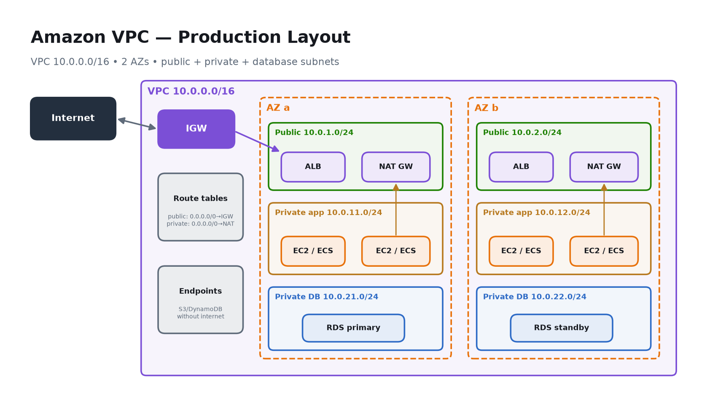

**What it is:** A **Virtual Private Cloud** is your own isolated network inside AWS. You choose the IP range (CIDR), split it into **subnets** (each subnet lives in **one AZ**), and control routing and firewalls.

**Why DevOps people care:** Every EC2, RDS, Lambda-in-VPC, ECS task and EKS pod lives in a VPC. Most "it can't connect" problems are VPC problems. Designing VPCs is a core cloud engineer task.

### 18.1 CIDR in 60 seconds

| CIDR | Number of IPs | Typical use |
|---|---|---|
| `10.0.0.0/16` | 65,536 | Whole VPC (the largest allowed) |
| `10.0.1.0/24` | 256 (**251 usable** in AWS) | One subnet |
| `10.0.1.0/28` | 16 (11 usable) | Smallest allowed subnet |

AWS reserves **5 IPs in every subnet**: network address, VPC router (.1), DNS (.2), future use (.3), broadcast (last).

> 💡 **Tip:** Plan CIDRs so they **don't overlap** with other VPCs, on-prem networks or other accounts. Overlapping ranges cannot be peered or connected later.

### 18.2 Subnet types

| Subnet | Route to internet | What goes there |
|---|---|---|
| **Public** | `0.0.0.0/0 → Internet Gateway` | Load balancers, NAT gateways, bastion (if any) |
| **Private (app)** | `0.0.0.0/0 → NAT Gateway` (outbound only) | App servers, ECS tasks, EKS nodes |
| **Private (isolated / DB)** | No internet route at all | Databases, caches |

A subnet is "public" **only because of its route table** — not because of its name.

### 18.3 Connecting VPCs and networks

| Option | Use |
|---|---|
| **VPC Peering** | Connect 2 VPCs (not transitive) |
| **Transit Gateway** | Hub-and-spoke for many VPCs and on-prem |
| **Site-to-Site VPN** | Encrypted tunnel to on-prem over the internet |
| **Direct Connect** | Dedicated private fibre to AWS |
| **PrivateLink** | Expose one service privately to other VPCs/accounts |

### Try it now

```bash
cd examples/vpc
./create-vpc.sh                 # 2-AZ VPC, public + private subnets, IGW, route tables, S3 endpoint
WITH_NAT=yes ./create-vpc.sh    # also a NAT Gateway (costs money hourly!)
```

---

## 19. Route Tables, Internet Gateway, NAT and Endpoints

| Component | What it does |
|---|---|
| **Route table** | Rules: "traffic for destination X goes to target Y". Each subnet is associated with one route table. The `local` route (VPC CIDR) always exists |
| **Internet Gateway (IGW)** | Lets resources **with public IPs** talk to the internet, both directions. One per VPC, free, highly available |
| **NAT Gateway** | Lets **private** resources make **outbound** connections (updates, APIs) while blocking inbound. Lives in a public subnet. Charged per hour + per GB. Use **one per AZ** for HA |
| **Egress-only IGW** | NAT-like outbound-only for IPv6 |
| **Gateway endpoint** | Private, **free** route to **S3 and DynamoDB** — no NAT needed |
| **Interface endpoint (PrivateLink)** | Private ENI for other AWS services (ECR, SSM, Secrets Manager…). Charged hourly |
| **VPC Flow Logs** | Logs of accepted/rejected traffic → CloudWatch Logs or S3. Essential for debugging |

Example route tables:

| Route table | Destination | Target |
|---|---|---|
| public-rt | `10.0.0.0/16` | local |
| public-rt | `0.0.0.0/0` | `igw-xxxx` |
| private-rt (AZ a) | `10.0.0.0/16` | local |
| private-rt (AZ a) | `0.0.0.0/0` | `nat-aaaa` (NAT in AZ a) |
| private-rt (AZ a) | S3 prefix list `pl-xxxx` | `vpce-xxxx` (gateway endpoint) |

```bash
aws ec2 describe-route-tables --filters Name=vpc-id,Values=vpc-0123 \
  --query "RouteTables[].{Id:RouteTableId,Routes:Routes[].[DestinationCidrBlock,GatewayId,NatGatewayId]}"
aws ec2 create-flow-logs --resource-type VPC --resource-ids vpc-0123 --traffic-type REJECT \
  --log-destination-type cloud-watch-logs --log-group-name vpc-flow \
  --deliver-logs-permission-arn arn:aws:iam::<ACCOUNT_ID>:role/flowlogs-role
```

> 💡 **Cost tip:** NAT Gateways are often a top-3 line item. Use **gateway endpoints** for S3/DynamoDB, interface endpoints for heavy ECR/SSM traffic, and avoid NAT entirely in labs.

---

## 20. Security Groups vs Network ACLs

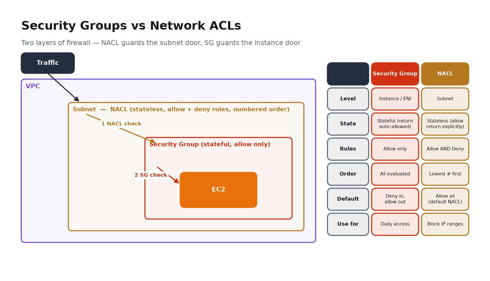

**What it is:** Two layers of firewall. **Security groups (SGs)** protect individual resources (ENIs). **Network ACLs (NACLs)** protect whole subnets.

**Why DevOps people care:** This is one of the **most asked** cloud interview topics, and the first thing to check when something can't connect.

| | **Security Group** | **Network ACL** |
|---|---|---|
| Applies to | Instance / ENI | Subnet |
| Stateful? | **Yes** — return traffic automatically allowed | **No** — must allow return traffic (ephemeral ports 1024-65535) |
| Rule types | **Allow only** | Allow **and Deny** |
| Rule evaluation | All rules evaluated together | **Lowest number first**, first match wins |
| Default | New SG: no inbound, all outbound | Default NACL: allow all. New custom NACL: deny all |
| Reference other SGs | **Yes** (e.g. "allow 5432 from `sg-app`") | No, CIDRs only |
| Typical use | Everyday access control | Block a bad IP range, extra subnet guardrail |

**Best-practice pattern (chain security groups):**

```
Internet ──80/443──▶ [sg-alb] ALB ──80──▶ [sg-app] App ──5432──▶ [sg-db] RDS
sg-alb : allow 443 from 0.0.0.0/0
sg-app : allow 80 from sg-alb          (not from the internet!)
sg-db  : allow 5432 from sg-app        (only the app can reach the DB)
```

See [`examples/vpc/nacl-rules.md`](examples/vpc/nacl-rules.md) for a full NACL example with ephemeral ports.

```bash
aws ec2 authorize-security-group-ingress --group-id sg-app \
  --protocol tcp --port 80 --source-group sg-alb
aws ec2 describe-security-groups --group-ids sg-app --query "SecurityGroups[0].IpPermissions"
```

> ⚠ **Warning:** Never open SSH (22) or RDP (3389) to `0.0.0.0/0`. Use **SSM Session Manager**. Never open databases to the internet.

---

## 21. Route 53 — DNS

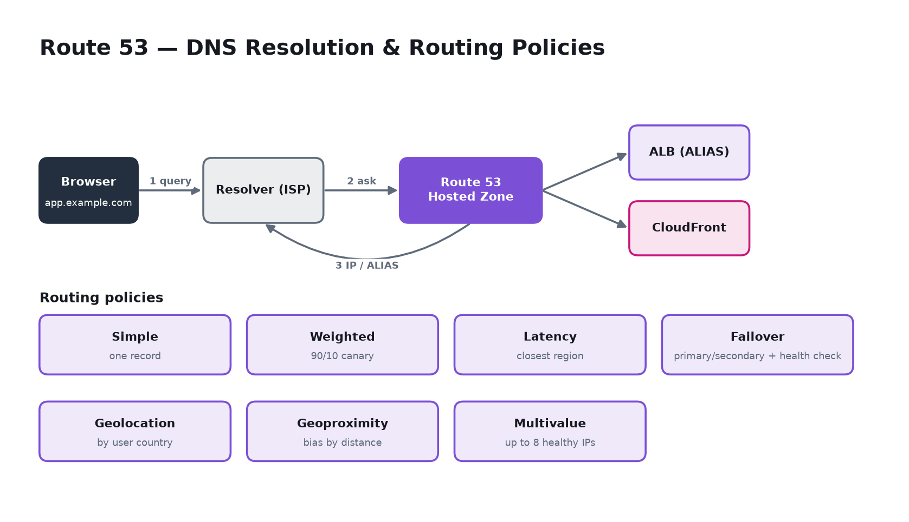

**What it is:** AWS's highly available **DNS** service: register domains, host DNS zones, route users with smart policies, and health-check endpoints. (Named after DNS port 53.)

**Why DevOps people care:** Every deployment ends with "point the domain at it". DNS is also a deployment tool: weighted records for canary releases, failover records for DR.

| Concept | Meaning |
|---|---|
| **Hosted zone** | Container of DNS records for a domain. **Public** (internet) or **private** (inside VPCs) |
| **A / AAAA** | Name → IPv4 / IPv6 |
| **CNAME** | Name → another name. **Not allowed at the zone apex** (`example.com`) |
| **Alias** (AWS special) | Like CNAME but works at the apex, free queries, points to ALB, CloudFront, S3 website, API Gateway… |
| **MX / TXT / NS / SOA** | Mail, verification text, name servers, zone authority |
| **TTL** | How long resolvers cache the answer. Lower it **before** a migration |
| **Health checks** | Monitor endpoints; used by failover routing and alarms |

| Routing policy | Use |
|---|---|
| Simple | One resource |
| Weighted | Canary / A-B testing (e.g. 90% v1, 10% v2) |
| Latency | Send users to the lowest-latency region |
| Failover | Active-passive DR with health checks |
| Geolocation | Route by user's country/continent (legal, language) |
| Geoproximity | Route by distance, with a bias to shift traffic |
| Multivalue answer | Return up to 8 healthy records |
| IP-based | Route by the client's IP range |

```bash
aws route53 list-hosted-zones
aws route53 list-resource-record-sets --hosted-zone-id Z0123456789
dig +short app.example.com          # see what the world resolves
dig app.example.com NS              # which name servers are authoritative
```

---

## 22. Elastic Load Balancing — ALB, NLB

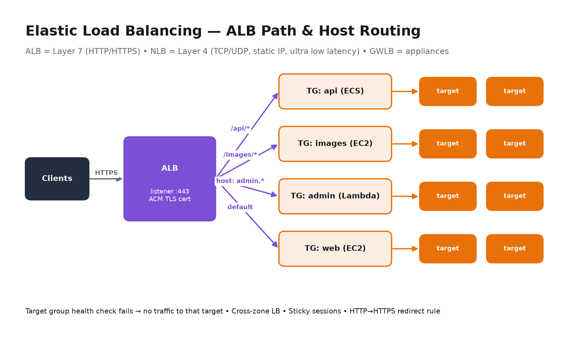

**What it is:** Managed load balancers that spread traffic across healthy targets (EC2, containers, IPs, Lambda) in multiple AZs.

**Why DevOps people care:** Load balancers enable zero-downtime deployments, health-based routing, TLS termination and horizontal scaling.

| Type | Layer | Highlights | Use for |
|---|---|---|---|
| **ALB** (Application) | 7 — HTTP/HTTPS/gRPC/WebSocket | Path/host/header routing, redirects, auth (Cognito/OIDC), WAF, Lambda targets | Web apps, APIs, microservices |
| **NLB** (Network) | 4 — TCP/UDP/TLS | Millions of req/s, very low latency, **static IP per AZ**, preserves client IP | Non-HTTP, gaming, IoT, PrivateLink |
| **GWLB** (Gateway) | 3 | Inserts third-party firewalls/appliances transparently | Network security appliances |
| CLB (Classic) | 4/7 | Legacy | Migrate away |

| Concept | Meaning |
|---|---|
| **Listener** | Port + protocol the LB accepts (e.g. HTTPS:443) with rules |
| **Rule** | Condition (path `/api/*`, host `admin.example.com`) → action (forward, redirect, fixed response) |
| **Target group** | Set of targets + **health check** settings |
| **Health check** | e.g. `GET /health` must return 200; unhealthy targets get no traffic |
| **TLS certificate** | Free certs from **ACM**, attached to the HTTPS listener |
| **Deregistration delay** | Lets in-flight requests finish during deploys (connection draining) |
| **Cross-zone load balancing** | Spread evenly across all targets in all AZs |
| **Sticky sessions** | Pin a user to one target (avoid if your app is stateless) |

```bash
aws elbv2 describe-load-balancers --query "LoadBalancers[].{Name:LoadBalancerName,DNS:DNSName,Type:Type}" --output table
aws elbv2 describe-target-health --target-group-arn <tg-arn> \
  --query "TargetHealthDescriptions[].{Target:Target.Id,State:TargetHealth.State,Reason:TargetHealth.Reason}" --output table
```

> 💡 **Tip:** "502/503 from the ALB" usually means **no healthy targets**. Check `describe-target-health`, the health check path, and that the app SG allows traffic **from the ALB's SG**.

---

## 23. CloudFront — CDN

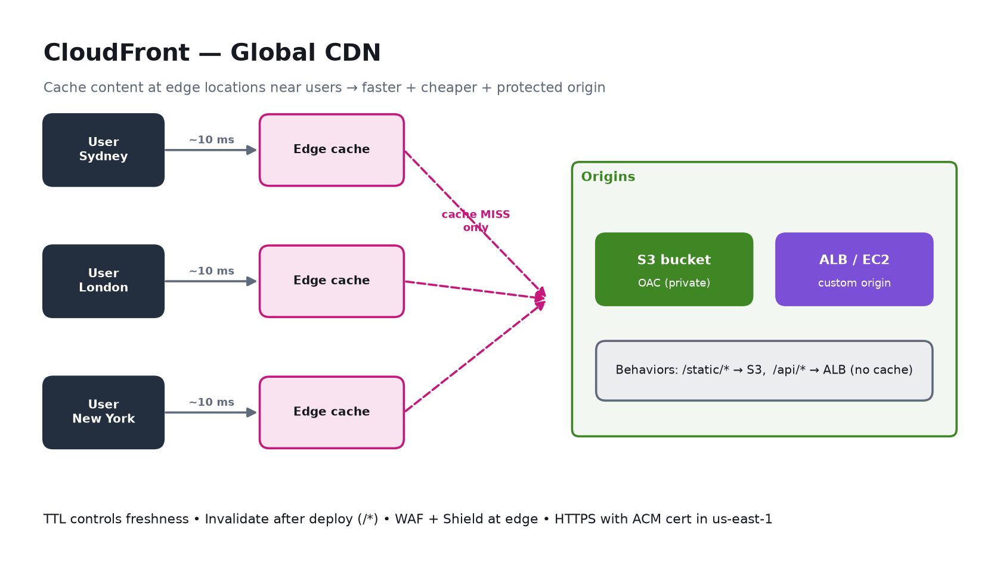

**What it is:** A global **Content Delivery Network**. It caches content at edge locations close to users and fetches from your **origin** (S3, ALB, API Gateway, any HTTP server) only on a cache miss.

**Why DevOps people care:** Faster sites, lower origin load and data-transfer cost, free TLS, and DDoS/WAF protection at the edge. Standard for frontends (React/Angular builds on S3 + CloudFront).

| Concept | Meaning |
|---|---|
| **Distribution** | Your CDN configuration with a `dxxxx.cloudfront.net` domain |
| **Origin** | Where content comes from. Use **OAC** (Origin Access Control) so the S3 bucket stays private |
| **Behaviors** | Path patterns → origin + cache policy (e.g. `/static/*` cached 1 year, `/api/*` not cached) |
| **TTL / cache policy** | How long the edge keeps objects; which headers/cookies/query strings form the cache key |
| **Invalidation** | Force refresh after a deploy (`/*`) — or better, use versioned file names |
| **ACM certificate** | Must be in **us-east-1** for CloudFront |
| **WAF / Shield** | Block attacks and bots at the edge |
| **CloudFront Functions / Lambda@Edge** | Run small code at the edge (redirects, headers, auth) |

```bash
# Typical frontend deploy step in CI
aws s3 sync ./build s3://my-site-bucket --delete
aws cloudfront create-invalidation --distribution-id E123EXAMPLE --paths "/*"
```

---

# PART 5: AWS Databases

## 24. RDS — Managed Relational Databases

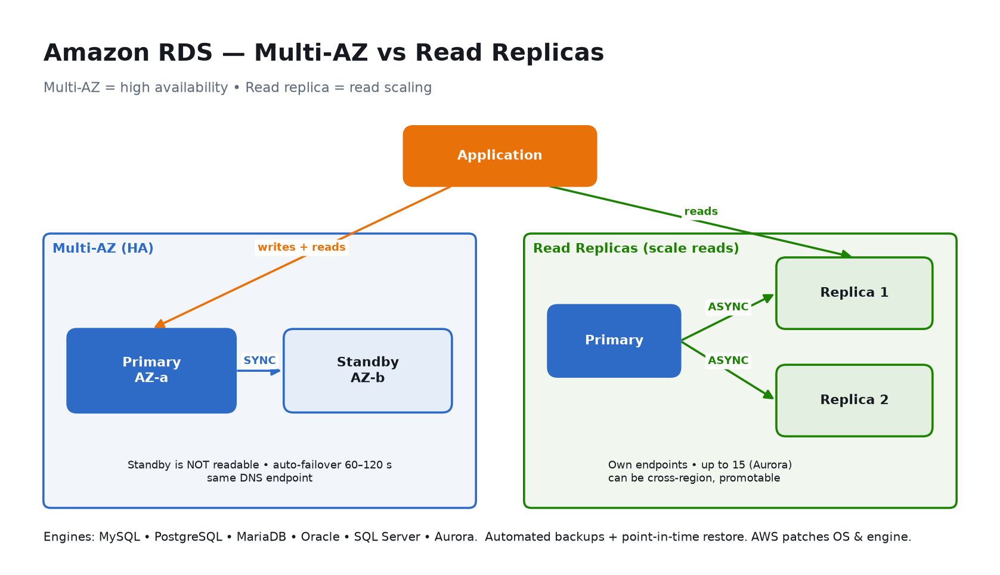

**What it is:** Relational Database Service — AWS runs MySQL, PostgreSQL, MariaDB, Oracle, SQL Server or **Aurora** for you: provisioning, OS and engine patching, backups, failover, monitoring.

**Why DevOps people care:** You will provision, secure, back up, upgrade and troubleshoot databases. Knowing **Multi-AZ vs read replica** is a guaranteed interview question.

| Feature | **Multi-AZ** | **Read replica** |
|---|---|---|
| Purpose | **High availability** | **Read scaling** (and DR if cross-region) |
| Replication | **Synchronous** | **Asynchronous** (may lag) |
| Can you read from it? | No (classic Multi-AZ instance) | Yes — own endpoint |
| Failover | Automatic, ~60–120 s, same DNS endpoint | Manual promotion |
| Cross-region | No | Yes |

> 💡 Newer option: **Multi-AZ DB cluster** (MySQL/PostgreSQL) — 1 writer + 2 **readable** standbys, faster failover.

| Feature | Notes |
|---|---|
| **Automated backups** | Daily snapshot + transaction logs, retention 1–35 days → **point-in-time restore** (creates a new instance) |
| **Manual snapshots** | Kept until you delete them; copy across regions/accounts |
| **Encryption** | KMS, must be chosen **at creation** (encrypt existing = snapshot → copy encrypted → restore) |
| **Parameter groups** | Engine settings (e.g. `max_connections`) |
| **Credentials** | Use `--manage-master-user-password` (stored and rotated in Secrets Manager) or IAM DB auth |
| **RDS Proxy** | Connection pooling — essential for Lambda → RDS |
| **Performance Insights** | Find slow queries and waits |
| **Aurora** | AWS cloud-native MySQL/PostgreSQL: storage replicated 6 ways across 3 AZs, up to 15 replicas, Serverless v2, Global Database |

### Try it now

```bash
cd examples/databases
./rds-postgres.sh        # private, encrypted PostgreSQL with managed master password
```

> ⚠ **Warning:** Never make a database `--publicly-accessible`. Put it in **private DB subnets** and allow its port **only from the app security group**.

---

## 25. DynamoDB — NoSQL

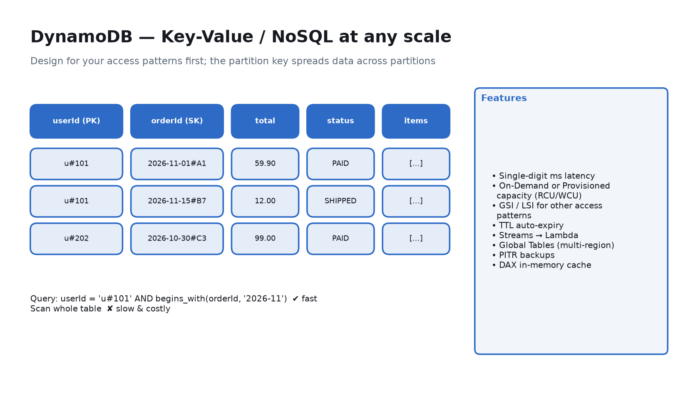

**What it is:** A fully managed, serverless **key-value and document** database with single-digit millisecond latency at any scale. No servers, no patching, no connection limits.

**Why DevOps people care:** Common for serverless apps, session stores, Terraform state locking (older setups), feature flags, and high-scale event data.

| Concept | Meaning |
|---|---|
| **Table / item / attribute** | Table of items (rows); items are schemaless except the key; max item size **400 KB** |
| **Partition key (PK)** | Hashed to choose the partition — choose high-cardinality keys to avoid "hot partitions" |
| **Sort key (SK)** | Optional; orders items within a partition, enables range queries (`begins_with`, `between`) |
| **Query vs Scan** | **Query** uses the key (fast, cheap). **Scan** reads the whole table (slow, expensive) |
| **GSI / LSI** | Secondary indexes for other access patterns. LSIs only at table creation |
| **Capacity modes** | **On-demand** (pay per request) or **Provisioned** (RCU/WCU + auto scaling) |
| **TTL** | Auto-delete expired items for free |
| **Streams** | Change log → Lambda (event-driven processing) |
| **Global Tables** | Multi-region, multi-active replication |
| **PITR** | Point-in-time recovery (35 days) |
| **DAX** | In-memory cache in front of DynamoDB (microseconds) |

### Try it now

```bash
cd examples/databases
./dynamodb.sh            # create table, put items, query vs scan, TTL
```

> 💡 **Design tip:** In SQL you design tables first, then queries. In DynamoDB you **list your access patterns first**, then design keys to serve them.

---

## 26. ElastiCache — In-Memory Cache

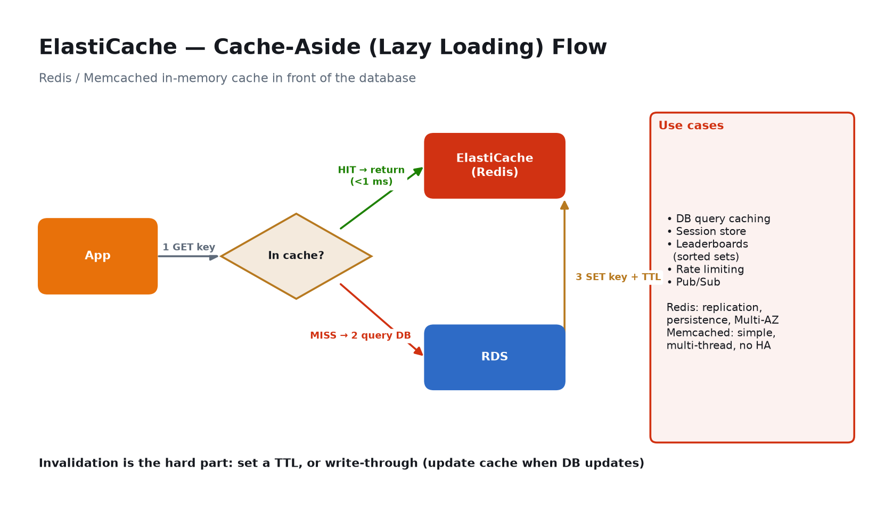

**What it is:** Managed **Redis OSS**, **Valkey** (open-source Redis fork) or **Memcached** — in-memory data stores with sub-millisecond latency.

**Why DevOps people care:** Caching is the cheapest way to make a slow app fast and to protect a database from load. Also used for sessions, rate limiting and queues.

| | **Redis OSS / Valkey** | **Memcached** |
|---|---|---|
| Data types | Strings, hashes, lists, sets, sorted sets, streams | Simple key-value strings |
| Replication / Multi-AZ failover | Yes | No |
| Persistence / backups | Yes | No |
| Pub/Sub, Lua, transactions | Yes | No |
| Multi-threaded | Mostly single-threaded per shard (cluster mode scales out) | Yes |
| Pick when | Almost always | Simplest cache, horizontal scaling, no HA needed |

**Caching strategies:**

| Strategy | How | Trade-off |
|---|---|---|
| **Cache-aside (lazy loading)** | App reads cache → on miss reads DB → writes cache with TTL | Only caches what's used; first read is slow; data can be stale until TTL |
| **Write-through** | App writes DB **and** cache together | Cache always fresh; writes slower; caches unused data |
| **TTL everywhere** | Every key expires | Limits staleness and memory use |

Example: [`examples/databases/cache_aside.py`](examples/databases/cache_aside.py) — first call ~1000 ms, second call ~1 ms.

> 💡 Also consider **ElastiCache Serverless** — no node sizing, scales automatically.

---

## 27. Choosing the Right Database

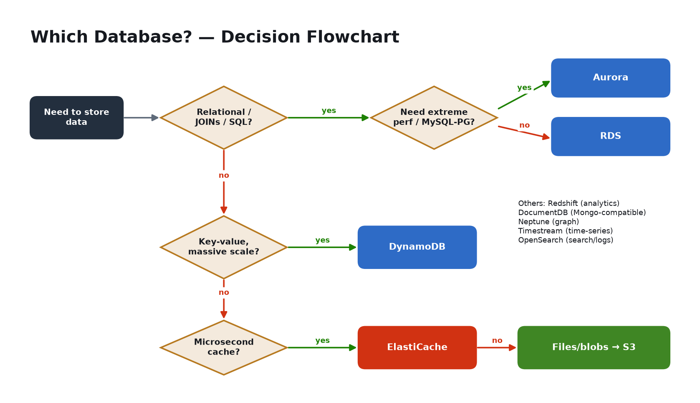

| Need | AWS service |
|---|---|
| Relational, transactions, joins | **RDS** (or **Aurora** for high scale/performance) |
| Key-value / document at massive scale, serverless | **DynamoDB** |
| Microsecond cache, sessions, leaderboards | **ElastiCache** (Redis OSS/Valkey) |
| Analytics / data warehouse | **Redshift** (or Athena on S3) |
| MongoDB-compatible documents | **DocumentDB** |
| Graph relationships | **Neptune** |
| Time-series | **Timestream** |
| Full-text search, log analytics | **OpenSearch Service** |
| Files, images, backups | **S3** (not a database!) |

---

# PART 6: Identity and Security

## 28. IAM — Users, Groups, Roles

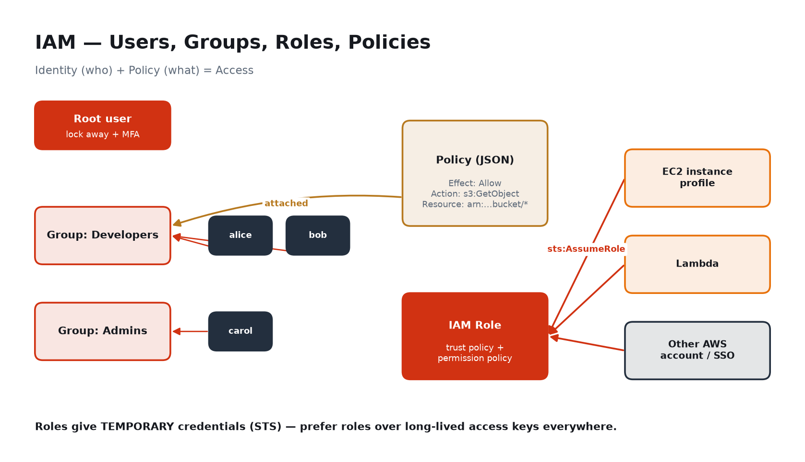

**What it is:** Identity and Access Management controls **who** (authentication) can do **what** on **which resources** (authorization) in your AWS account. IAM is **global** and free.

**Why DevOps people care:** Every pipeline, server, container and human needs permissions. Getting IAM wrong means either broken deployments (too little) or a security breach (too much).

| Identity | What it is | Credentials | Use for |
|---|---|---|---|
| **Root user** | The account owner email | Password (+ MFA!) | Billing and a few account-level tasks only. **Lock it away** |
| **IAM user** | A long-lived identity | Password and/or **access keys** | Legacy / break-glass. Prefer Identity Center for humans |
| **IAM group** | Collection of users | — (not an identity) | Attach policies once for many users (`Developers`, `Admins`) |
| **IAM role** | An identity **assumed** temporarily | **Temporary** STS credentials (expire) | EC2, Lambda, ECS tasks, CI/CD (OIDC), cross-account access, SSO users |
| **IAM Identity Center** | Central SSO for humans across accounts | Short-lived, via login portal | **Recommended** for all human access |

### 28.1 How roles work

1. A role has a **trust policy** — *who* may assume it (e.g. `ec2.amazonaws.com`, a GitHub OIDC repo, another account).
2. A role has **permission policies** — *what* it can do once assumed.
3. The caller calls **`sts:AssumeRole`** (done automatically for EC2/Lambda/ECS) and gets temporary keys.

```bash
# Create a role EC2 can use, with read-only access to one bucket
aws iam create-role --role-name lesson-ec2-role \
  --assume-role-policy-document file://examples/iam/ec2-trust-policy.json
aws iam put-role-policy --role-name lesson-ec2-role --policy-name read-one-bucket \
  --policy-document file://examples/iam/s3-read-only-one-bucket.json
aws iam create-instance-profile --instance-profile-name lesson-ec2-profile
aws iam add-role-to-instance-profile --instance-profile-name lesson-ec2-profile --role-name lesson-ec2-role

# Assume a role yourself (e.g. cross-account) and see the temporary credentials
aws sts assume-role --role-arn arn:aws:iam::<ACCOUNT_ID>:role/ReadOnly --role-session-name test
```

> ⚠ **Golden rule:** **No long-lived access keys** on servers, in containers, in code, or in CI. Use **roles** (instance profile, task role, IRSA/Pod Identity) and **OIDC** for GitHub Actions/GitLab ([`examples/cicd/github-actions-deploy.yml`](examples/cicd/github-actions-deploy.yml)).

---

## 29. IAM Policies and Least Privilege

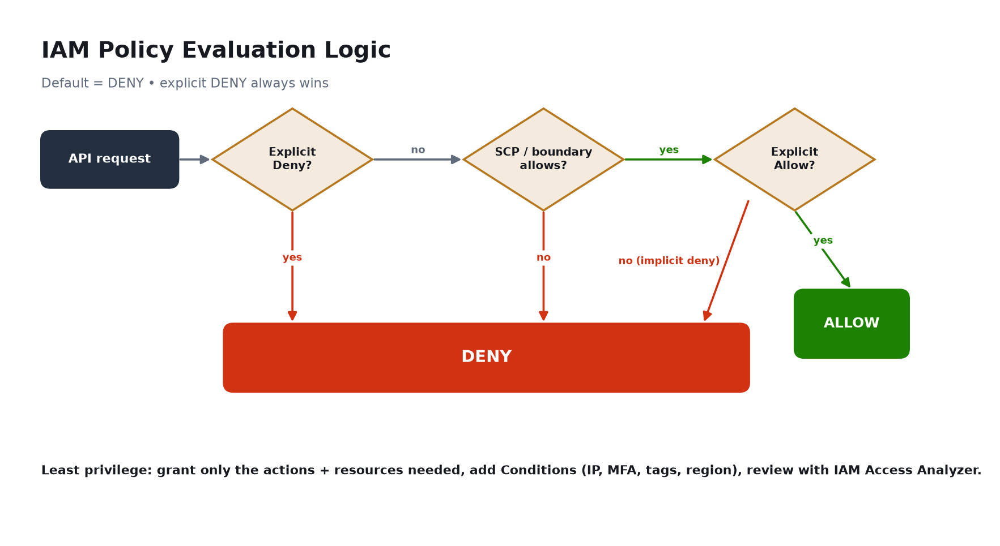

**What it is:** Policies are JSON documents that **Allow** or **Deny** actions on resources, optionally with **conditions**.

**Why DevOps people care:** You will read and write policies every week — for pipelines, apps, buckets and users.

### 29.1 Anatomy of a policy

```json
{
  "Version": "2012-10-17",
  "Statement": [
    {
      "Sid": "ReadObjectsInThisBucket",
      "Effect": "Allow",
      "Action": "s3:GetObject",
      "Resource": "arn:aws:s3:::my-app-artifacts/*",
      "Condition": { "Bool": { "aws:SecureTransport": "true" } }
    }
  ]
}
```

| Element | Meaning |
|---|---|
| **Effect** | `Allow` or `Deny` |
| **Action** | API calls, e.g. `s3:GetObject`, `ec2:StartInstances`, `dynamodb:*` |
| **Resource** | ARNs the statement applies to (`arn:aws:service:region:account:resource`) |
| **Principal** | *Who* — only in resource-based and trust policies |
| **Condition** | Extra rules: source IP, MFA, tags, region, time, VPC endpoint… |

### 29.2 Policy types

| Type | Attached to | Example |
|---|---|---|
| **AWS managed** | Users/groups/roles | `ReadOnlyAccess`, `AmazonSSMManagedInstanceCore` |
| **Customer managed** | Users/groups/roles (reusable, versioned) | Your company's `deploy-ecs` policy |
| **Inline** | Embedded in one identity | One-off, tightly coupled permissions |
| **Resource-based** | The resource itself | S3 bucket policy, SQS queue policy, KMS key policy, Lambda resource policy |
| **Trust policy** | A role | Who can assume the role |
| **Permissions boundary** | User/role | Maximum permissions a delegated admin can grant |
| **SCP** (Service Control Policy) | AWS Organizations OU/account | Guardrail: e.g. deny all regions except two ([`deny-outside-allowed-regions.json`](examples/iam/deny-outside-allowed-regions.json)) |

### 29.3 Evaluation logic (memorise this)

1. By default everything is **implicitly denied**.
2. An **explicit Deny** anywhere **always wins**.
3. Otherwise, the request needs an **Allow** — and it must be allowed by every guardrail layer (SCP, permissions boundary, session policy) that applies.

### 29.4 Least privilege checklist

- Start from **zero** and add only the actions + resources needed. Avoid `"Action": "*"` and `"Resource": "*"`.
- Use **conditions** (MFA required: [`require-mfa.json`](examples/iam/require-mfa.json), source VPC, tags).
- Use **IAM Access Analyzer** to find public/cross-account access and to **generate policies from CloudTrail activity**.
- Review **last accessed** data and remove unused permissions, users and keys.
- Separate accounts for **dev / staging / prod** with AWS Organizations.
- Rotate or (better) eliminate access keys; enforce **MFA** for humans.

```bash
aws iam simulate-principal-policy --policy-source-arn arn:aws:iam::<ACCOUNT_ID>:role/lesson-ec2-role \
  --action-names s3:GetObject s3:PutObject \
  --resource-arns arn:aws:s3:::my-app-artifacts-123456789012/file.txt \
  --query "EvaluationResults[].{Action:EvalActionName,Decision:EvalDecision}" --output table
# GetObject -> allowed, PutObject -> implicitDeny
```

---

## 30. Secrets Manager and Systems Manager

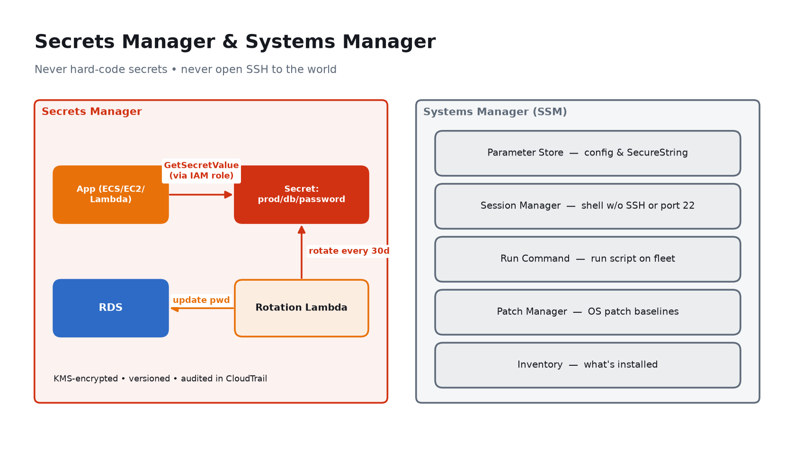

**What it is:**
- **Secrets Manager** — stores, encrypts (KMS), and **automatically rotates** secrets such as DB passwords and API keys.
- **Systems Manager (SSM)** — a toolbox for operating servers at scale: **Parameter Store**, **Session Manager**, **Run Command**, **Patch Manager**, **Inventory**, **Automation**.

**Why DevOps people care:** Hard-coded secrets in Git are a top cause of breaches. SSM removes the need for SSH keys and bastion hosts and automates patching.

| | **Secrets Manager** | **SSM Parameter Store** |
|---|---|---|
| Built for | Secrets that need **rotation** | Config values and simple secrets |
| Rotation | Built-in (RDS, Redshift, DocumentDB) + custom Lambda | No built-in rotation |
| Cost | Per secret per month + API calls | Standard tier **free** |
| Size | Up to 64 KB | 4 KB (standard), 8 KB (advanced) |
| Cross-account / replication | Yes | Limited |

| SSM feature | Replaces |
|---|---|
| **Session Manager** | SSH keys, port 22, bastion hosts (sessions logged to S3/CloudWatch) |
| **Run Command** | Looping `ssh` over servers |
| **Patch Manager** | Manual `yum update` on each box |
| **Parameter Store** | `.env` files on servers |
| **Automation runbooks** | Manual ops procedures (e.g. "restart service and create snapshot") |

### Try it now

```bash
./examples/security/secrets-and-ssm.sh
```

```python
# Reading a secret in app code (boto3) — permissions come from the IAM role, not keys
import boto3, json
secret = json.loads(boto3.client("secretsmanager").get_secret_value(SecretId="dev/lesson/db")["SecretString"])
```

> 💡 **Also know:** **KMS** (Key Management Service) creates and controls the encryption keys used by S3, EBS, RDS, Secrets Manager and more. **ACM** issues free TLS certificates. **GuardDuty** detects threats, **Security Hub** aggregates findings, **WAF** protects web apps, **AWS Config** tracks resource configuration and compliance.

---

# PART 7: Monitoring and Messaging

## 31. CloudWatch and CloudTrail

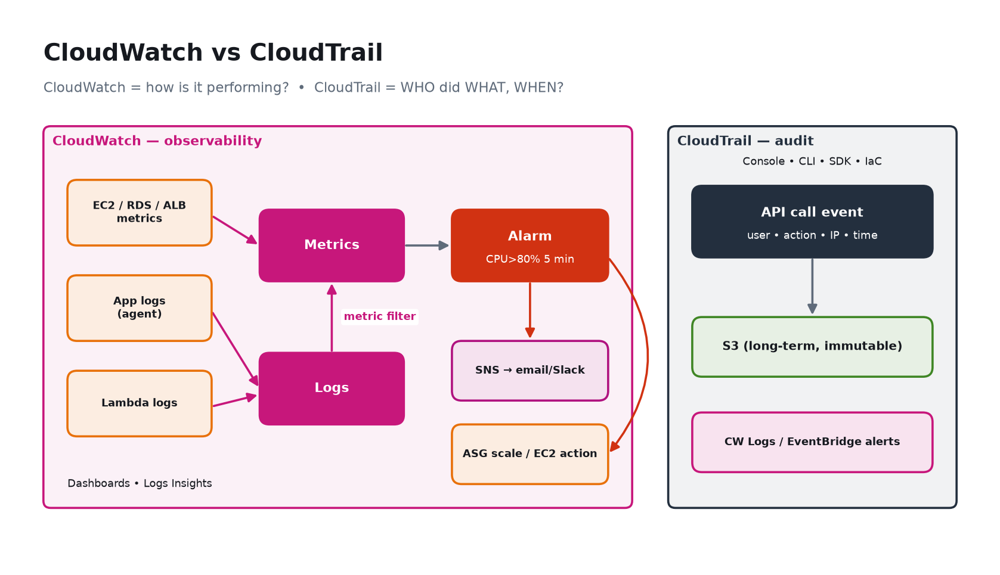

**What it is:**
- **CloudWatch** = **observability**: metrics, logs, alarms, dashboards, events. *"How is my system performing?"*
- **CloudTrail** = **audit**: a record of every API call in your account. *"Who did what, when, from where?"*

**Why DevOps people care:** You can't operate what you can't see. Alarms page the on-call engineer; logs explain the incident; CloudTrail tells you who changed the security group.

### 31.1 CloudWatch building blocks

| Feature | Notes |
|---|---|
| **Metrics** | Time-series numbers. EC2 basic monitoring = 5-min, detailed = 1-min. **Memory and disk need the CloudWatch agent** |
| **Custom metrics** | Publish your own (orders/min, queue lag) via API or Embedded Metric Format |
| **Logs** | Log groups → log streams. Set **retention** (default is never expire = growing cost) |
| **Logs Insights** | Query language for logs ([examples](examples/monitoring/logs-insights-queries.md)) |
| **Metric filters** | Turn log patterns (e.g. `ERROR`) into metrics → alarms |
| **Alarms** | Threshold on a metric → SNS notify, Auto Scaling action, EC2 action (reboot/recover) |
| **Composite alarms** | Combine alarms to reduce noise |
| **Dashboards** | Shared graphs for the team |
| **Synthetics / RUM / Application Signals** | Canary tests, real-user monitoring, APM |
| **EventBridge** (formerly CloudWatch Events) | React to events and schedules (cron) |

### 31.2 CloudTrail

| Feature | Notes |
|---|---|
| **Event history** | Last **90 days** of management events, free, per region |
| **Trail** | Deliver events to **S3** (long-term) and CloudWatch Logs (alerting). Make it multi-region + org-wide |
| **Management vs data events** | Management = control plane (`RunInstances`). Data = high-volume (`S3 GetObject`, Lambda `Invoke`) — opt-in, extra cost |
| **Log file validation** | Prove logs weren't tampered with |
| **CloudTrail Lake** | SQL queries over events |

### Try it now

```bash
./examples/monitoring/cloudwatch-alarm.sh i-0123456789abcdef0 you@example.com
aws logs tail /aws/lambda/lesson-hello --since 1h --follow
aws logs put-retention-policy --log-group-name /aws/lambda/lesson-hello --retention-in-days 14
aws cloudtrail lookup-events --lookup-attributes AttributeKey=EventName,AttributeValue=AuthorizeSecurityGroupIngress --max-results 5
```

> 💡 **Monitoring golden signals:** **latency, traffic, errors, saturation**. Build one dashboard and one alarm for each on every service.

---

## 32. SNS and SQS

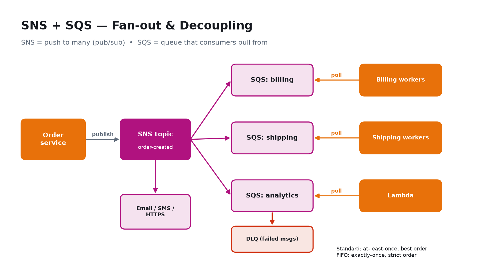

**What it is:**
- **SNS** (Simple Notification Service) — **pub/sub push**. Publish one message to a **topic**; it's pushed to all subscribers (SQS, Lambda, HTTPS, email, SMS).
- **SQS** (Simple Queue Service) — a **queue**. Producers send messages; consumers **poll**, process, then **delete** them. Messages wait safely until processed.

**Why DevOps people care:** Queues **decouple** services: if the consumer is down or slow, messages wait instead of being lost. This is how you build resilient, scalable systems — and how you absorb traffic spikes.

| | **SNS** | **SQS** |
|---|---|---|
| Model | Push, one-to-many (fan-out) | Pull, one consumer group per queue |
| Stores messages? | No (delivers immediately, retries) | Yes — default 4 days, max 14 days |
| Consumers | SQS, Lambda, HTTP, email, SMS, Firehose | Your workers, Lambda (event source mapping) |
| Ordering | FIFO topics available | Standard (best-effort order) or **FIFO** (strict order, exactly-once processing) |

| SQS concept | Meaning |
|---|---|
| **Visibility timeout** | After a consumer receives a message, it's hidden for N seconds. Not deleted in time → reappears (retry) |
| **Long polling** | `WaitTimeSeconds` up to 20 — fewer empty responses, lower cost |
| **Dead-letter queue (DLQ)** | After `maxReceiveCount` failures, the message moves to the DLQ for inspection |
| **Standard queue** | Nearly unlimited throughput, **at-least-once** delivery (consumers must be **idempotent**) |
| **FIFO queue** | Strict ordering per message group, deduplication |
| **Delay queue** | Postpone delivery of new messages |
| **Large payloads** | Store the body in S3 and send a pointer in the message |

**Fan-out pattern:** `Order service → SNS topic → [SQS billing, SQS shipping, SQS analytics]` — each team gets its own copy and processes at its own speed.

### Try it now

```bash
./examples/messaging/sns-sqs-fanout.sh      # topic + 2 queues + DLQ, publish once, read twice
```

> 💡 **Also know:** **EventBridge** (event bus with content-based routing rules and SaaS integrations), **Kinesis** (real-time streaming, ordered, replayable), **Step Functions** (orchestrate multi-step workflows), **Amazon MQ** (managed RabbitMQ/ActiveMQ for legacy protocols).

---

# PART 8: Azure and GCP Equivalents

> 💡 Learn AWS **deeply** first. Every concept you learned (regions, VPCs, IAM, object storage, managed K8s) exists on Azure and GCP with different names and some different defaults.

## 33. AWS to Azure to GCP Service Map

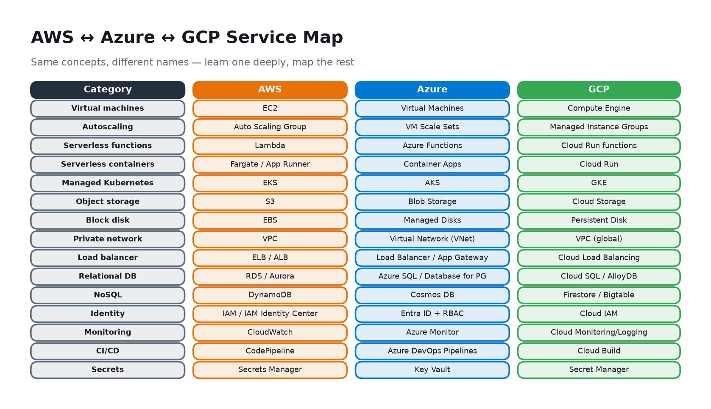

| Category | AWS | Azure | GCP |
|---|---|---|---|
| Virtual machines | EC2 | Virtual Machines | Compute Engine |
| Autoscaling | Auto Scaling Groups | VM Scale Sets | Managed Instance Groups |
| Serverless functions | Lambda | Azure Functions | Cloud Run functions |
| Serverless containers | Fargate / App Runner | Container Apps / Container Instances | Cloud Run |
| Managed Kubernetes | EKS | AKS | GKE |
| Container registry | ECR | Azure Container Registry (ACR) | Artifact Registry |
| Object storage | S3 | Blob Storage | Cloud Storage |
| Archive storage | S3 Glacier | Blob Archive tier | Archive storage class |
| Block storage | EBS | Managed Disks | Persistent Disk / Hyperdisk |
| File storage | EFS | Azure Files | Filestore |
| Private network | VPC | Virtual Network (VNet) | VPC (**global**) |
| Firewall | Security Groups / NACLs | Network Security Groups (NSG) | VPC firewall rules |
| Load balancer (L7) | ALB | Application Gateway / Front Door | External Application LB |
| DNS | Route 53 | Azure DNS / Traffic Manager | Cloud DNS |
| CDN | CloudFront | Azure Front Door / CDN | Cloud CDN |
| Relational DB | RDS / Aurora | Azure SQL Database / Database for PostgreSQL & MySQL | Cloud SQL / AlloyDB / Spanner |
| NoSQL | DynamoDB | Cosmos DB | Firestore / Bigtable |
| Cache | ElastiCache | Azure Cache for Redis / Managed Redis | Memorystore |
| Identity | IAM / IAM Identity Center | **Entra ID** + Azure RBAC | Cloud IAM / Cloud Identity |
| Secrets | Secrets Manager / Parameter Store | Key Vault / App Configuration | Secret Manager |
| Monitoring | CloudWatch | Azure Monitor / Log Analytics | Cloud Monitoring / Cloud Logging |
| Audit | CloudTrail | Activity Log | Cloud Audit Logs |
| Messaging | SNS / SQS | Service Bus / Event Grid / Queue Storage | Pub/Sub |
| IaC (native) | CloudFormation / CDK | Bicep / ARM templates | Infrastructure Manager (Terraform) |
| CI/CD | CodePipeline / CodeBuild | **Azure DevOps** Pipelines / GitHub Actions | Cloud Build / Cloud Deploy |

---

## 34. Microsoft Azure Essentials

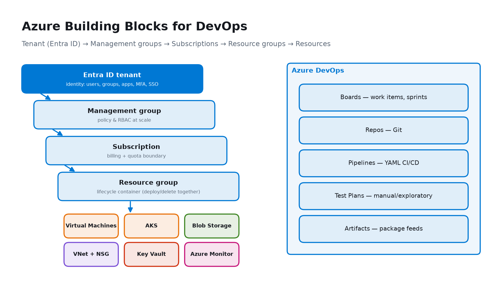

**Why DevOps people care:** Azure is #2 in the market and dominant in enterprises that already use Microsoft 365, Windows and Active Directory. **Azure DevOps** is a very common CI/CD platform.

### 34.1 How Azure is organised

| Level | Purpose | AWS analogy |
|---|---|---|
| **Entra ID tenant** | Identity directory (users, groups, apps, SSO, MFA, Conditional Access) — formerly *Azure AD* | IAM Identity Center + IdP |
| **Management group** | Group subscriptions; apply Azure Policy and RBAC at scale | AWS Organizations OU |
| **Subscription** | Billing and quota boundary | AWS account |
| **Resource group** | Logical container; resources deployed and **deleted together** | (no direct equivalent — tags / CloudFormation stack) |
| **Resource** | VM, storage account, AKS cluster… | Resource |

### 34.2 Key services

| Service | Notes |
|---|---|
| **Virtual Machines** | Sizes like `Standard_B1s`; **Availability Sets** and **Availability Zones**; **VM Scale Sets** for autoscaling |
| **AKS** | Managed Kubernetes; control plane free (Free tier) or paid Standard tier with SLA; integrates with Entra ID and ACR |
| **Blob Storage** | Inside a **storage account**; containers ≈ buckets; access tiers **Hot, Cool, Cold, Archive**; redundancy LRS / ZRS / GRS / GZRS |
| **VNet + NSG** | NSG rules have **priorities** (lower first) and support allow **and** deny, can attach to subnet or NIC |
| **Entra ID + Azure RBAC** | Roles (`Owner`, `Contributor`, `Reader`, custom) assigned at a **scope** (management group → subscription → RG → resource). **Managed identities** = Azure's version of IAM roles for services |
| **Key Vault** | Secrets, keys, certificates |
| **Azure Monitor** | Metrics, Log Analytics (KQL queries), Application Insights |

### 34.3 Azure DevOps

| Component | Purpose |
|---|---|
| **Boards** | Work items, backlogs, sprints (like Jira) |
| **Repos** | Git hosting with PR policies |
| **Pipelines** | YAML CI/CD for any language/cloud — see [`examples/azure/azure-pipelines.yml`](examples/azure/azure-pipelines.yml) |
| **Test Plans** | Manual and exploratory testing |
| **Artifacts** | Package feeds (npm, NuGet, Maven, PyPI) |

Concepts: **stages → jobs → steps**, **agents** (Microsoft-hosted or self-hosted), **service connections** (credentials to Azure/AWS/registries — use **workload identity federation**, Azure's OIDC), **environments** with approvals, **variable groups** linked to Key Vault.

### Try it now

```bash
az login
./examples/azure/azure-basics.sh          # RG, VNet, NSG, VM, storage account, blob upload
az group delete -n lesson-rg --yes --no-wait   # cleanup: one command deletes everything
```

---

## 35. Google Cloud Essentials

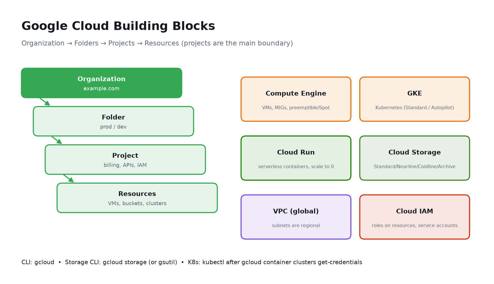

**Why DevOps people care:** GCP is strong in Kubernetes (Google created it), data/ML, and developer-friendly serverless (**Cloud Run**).

### 35.1 How GCP is organised

| Level | Purpose |
|---|---|
| **Organization** | Root node tied to your domain |
| **Folders** | Group projects (by team or environment) |
| **Project** | The main boundary for resources, billing, APIs and IAM (≈ AWS account) |
| **Resources** | VMs, buckets, clusters |

### 35.2 Key services

| Service | Notes |
|---|---|
| **Compute Engine** | VMs (`e2-micro`, `n2-standard-4`…); **Managed Instance Groups** for autoscaling; **Spot VMs**; **sustained-use discounts** applied automatically |
| **GKE** | Managed Kubernetes. **Autopilot** (Google manages nodes, pay per pod) or **Standard** (you manage node pools). Workload Identity for pod permissions |
| **Cloud Storage** | Buckets; classes **Standard, Nearline (30 d), Coldline (90 d), Archive (365 d)**; uniform bucket-level access; Autoclass |
| **Cloud Run** | Run any container, HTTP-triggered, **scales to zero**, pay per request — the fastest way to ship a container |
| **VPC** | **Global** VPC with **regional** subnets; firewall rules target instances by **network tags** or service accounts |
| **Cloud IAM** | **Principals** get **roles** (basic, predefined, custom) on resources; **service accounts** for workloads; inherited down the hierarchy |

### Try it now

```bash
gcloud auth login && gcloud config set project YOUR_PROJECT_ID
./examples/gcp/gcp-basics.sh             # VM + firewall, bucket, Cloud Run service
```

---

# PART 9: Putting It All Together

## 36. Reference Architecture: 3-Tier Web App

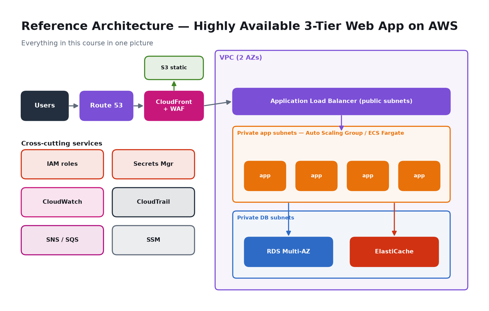

This is the architecture interviewers love to ask you to draw. Walk through it like this:

1. **User → Route 53** resolves `app.example.com` (alias record) to **CloudFront**.
2. **CloudFront + WAF** serves static assets from a **private S3 bucket** (OAC) and forwards `/api/*` to the **ALB**.
3. The **ALB** sits in **public subnets** in 2 AZs, terminates TLS (ACM certificate), and routes to healthy targets.
4. The **app tier** runs in **private subnets** as an **Auto Scaling Group** or **ECS Fargate service**, scaling on CPU/requests. Outbound internet via **NAT Gateways** (one per AZ).
5. The **data tier** in **isolated subnets**: **RDS Multi-AZ** (writes) + read replica (reads) + **ElastiCache** (sessions, hot data).
6. **Security groups** are chained: `ALB SG → App SG → DB SG`.
7. **IAM roles** give the app access to S3/SQS; **Secrets Manager** holds the DB password; no SSH — **SSM Session Manager**.
8. **CloudWatch** dashboards + alarms → **SNS** → on-call; **CloudTrail** for audit; **SQS** to offload slow jobs (emails, image processing).
9. **Everything is defined in IaC** (Terraform/CloudFormation) and deployed through a **CI/CD pipeline**.

**Well-Architected Framework — the 6 pillars** (use these words in design discussions):

| Pillar | Ask yourself |
|---|---|
| **Operational excellence** | Is it automated, observable, deployed via IaC/CI/CD? |
| **Security** | Least privilege? Encrypted? Traceable? |
| **Reliability** | Multi-AZ? Self-healing? Backups tested? |
| **Performance efficiency** | Right service and size? Caching? |
| **Cost optimisation** | Right-sized? Savings Plans/Spot? Idle resources removed? |
| **Sustainability** | Efficient instance types (Graviton), scale to zero when idle? |

---

## 37. DevOps on the Cloud: IaC and CI/CD

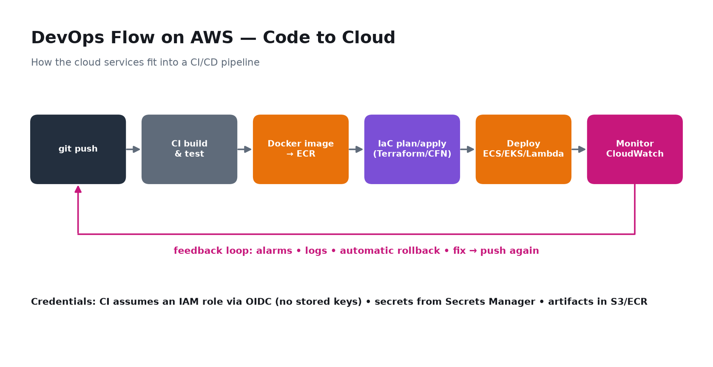

### 37.1 Infrastructure as Code (IaC)

Clicking in the console is fine for learning. **Real environments are built from code** so they are repeatable, reviewable and recoverable.

| Tool | Notes | Example in this repo |
|---|---|---|
| **Terraform / OpenTofu** | Multi-cloud, huge ecosystem, `plan` before `apply`, state file | [`examples/terraform/`](examples/terraform/) |
| **CloudFormation** | AWS native YAML/JSON, stacks, drift detection, change sets | [`examples/cloudformation/vpc-web.yaml`](examples/cloudformation/vpc-web.yaml) |
| **AWS CDK** | Write CloudFormation in TypeScript/Python | — |
| **Bicep** | Azure native | — |
| **Pulumi** | IaC in general-purpose languages, multi-cloud | — |

```bash
# Terraform workflow
cd examples/terraform
terraform init          # download providers
terraform fmt && terraform validate
terraform plan          # preview — ALWAYS read this
terraform apply
terraform output web_url
terraform destroy       # cleanup

# CloudFormation workflow
cd examples/cloudformation
aws cloudformation deploy --template-file vpc-web.yaml --stack-name lesson-web --capabilities CAPABILITY_IAM
aws cloudformation describe-stacks --stack-name lesson-web --query "Stacks[0].Outputs" --output table
aws cloudformation delete-stack --stack-name lesson-web
```

> 💡 **Terraform state:** store it remotely (S3 with locking), encrypt it, never commit it to Git — it can contain secrets. This repo's [`.gitignore`](.gitignore) already excludes `*.tfstate`.

### 37.2 CI/CD to the cloud

| Practice | How |
|---|---|
| **No stored cloud keys in CI** | GitHub Actions / GitLab / Azure DevOps → **OIDC** → assume an IAM role ([trust policy](examples/iam/github-oidc-trust-policy.json)) |
| **Build once, deploy many** | Build the image once, tag with the Git SHA, push to ECR, promote the same image dev → staging → prod |
| **Scan** | ECR image scanning, IaC scanning (Checkov, tfsec/Trivy), secret scanning |
| **Safe deploys** | Rolling (ECS), blue/green (CodeDeploy, ALB weighted target groups), canary (Lambda aliases, Route 53 weighted) |
| **Automatic rollback** | Deploy circuit breaker (ECS), CloudWatch alarms on error rate |
| **Separate accounts** | dev / staging / prod accounts via AWS Organizations |

Full pipeline example: [`examples/cicd/github-actions-deploy.yml`](examples/cicd/github-actions-deploy.yml) (OIDC → ECR push → ECS deploy and wait for healthy).

---

## 38. Hands-on Labs

Do these in order. Each one builds on the previous. **Always clean up.**

| # | Lab | What you'll prove you can do | Files |
|---|---|---|---|
| 0 | Secure account setup | MFA, budget alert, CLI profile | [cost/budget.sh](examples/cost/budget.sh) |
| 1 | First web server | Launch EC2 with user data, debug connectivity | [ec2/](examples/ec2/) |
| 2 | Secure S3 bucket | Block public access, versioning, lifecycle, presigned URLs | [s3/](examples/s3/) |
| 3 | Build a VPC by hand | Subnets, IGW, route tables, endpoints | [vpc/](examples/vpc/) |
| 4 | Load-balanced, self-healing web tier | ALB + ASG across 2 AZs, kill an instance and watch it heal | [cloudformation/vpc-web.yaml](examples/cloudformation/vpc-web.yaml) |
| 5 | IAM least privilege | Role for EC2 that can read one bucket only, prove it with the policy simulator | [iam/](examples/iam/) |
| 6 | Serverless function | Lambda triggered by API and S3 events, view logs | [lambda/](examples/lambda/) |
| 7 | Containers on Fargate | Push to ECR, run a service on ECS Fargate | [ecs/](examples/ecs/) |
| 8 | Databases | Private RDS PostgreSQL + DynamoDB access patterns + Redis cache-aside | [databases/](examples/databases/) |
| 9 | Observability | CPU alarm → SNS email, Logs Insights queries, CloudTrail lookups | [monitoring/](examples/monitoring/) |
| 10 | Decoupling | SNS fan-out to SQS queues with a DLQ | [messaging/](examples/messaging/) |
| 11 | Secrets and no-SSH ops | Secrets Manager, Parameter Store, Session Manager | [security/](examples/security/) |
| 12 | Infrastructure as Code | Same stack with Terraform: plan, apply, destroy | [terraform/](examples/terraform/) |
| 13 | Kubernetes | EKS cluster with eksctl, deploy app + HPA | [eks/](examples/eks/) |
| 14 | CI/CD with OIDC | GitHub Actions deploys to ECS without stored keys | [cicd/](examples/cicd/) |
| 15 | Multi-cloud | Repeat Labs 1, 2 and 7 on Azure and GCP | [azure/](examples/azure/), [gcp/](examples/gcp/) |
| 16 | Capstone | Build the [3-tier reference architecture](#36-reference-architecture-3-tier-web-app) in Terraform, deploy via CI/CD, add dashboards and alarms, write a README with a diagram and cost estimate | your own repo |

> 💡 **Portfolio tip:** Put the capstone in a public GitHub repo with an architecture diagram, IaC, pipeline, and a short "decisions and trade-offs" section. That is what gets interns hired.

---

## 39. Interview Questions

<details>
<summary><b>1. What is the difference between IaaS, PaaS and SaaS? Give AWS examples.</b></summary>

IaaS gives you raw infrastructure and you manage the OS upward (EC2). PaaS manages the OS and runtime, you deploy code (Elastic Beanstalk, RDS as a managed DB platform). SaaS is complete software you just use (WorkMail, Microsoft 365). The higher you go, the less you manage and the less control you have.
</details>

<details>
<summary><b>2. What is a Region vs an Availability Zone? How do you design for high availability?</b></summary>

A Region is a geographic area with multiple isolated AZs. An AZ is one or more data centres with independent power/network. For HA, deploy across at least 2 AZs: ALB across AZs, ASG/ECS spread across AZs, RDS Multi-AZ, NAT Gateway per AZ. For DR against a regional outage, replicate to a second region (S3 CRR, Aurora Global Database, DynamoDB Global Tables, Route 53 failover).
</details>

<details>
<summary><b>3. Explain the Shared Responsibility Model.</b></summary>

AWS secures the cloud (facilities, hardware, hypervisor, network, managed-service infrastructure). The customer secures what's in the cloud: data, IAM, OS patching on EC2, network config (SGs/NACLs), encryption choices, application code. The split shifts with the service: more customer responsibility on EC2, less on Lambda/S3.
</details>

<details>
<summary><b>4. Security Group vs NACL?</b></summary>

SG: instance-level, stateful, allow rules only, all rules evaluated, can reference other SGs. NACL: subnet-level, stateless (return traffic must be allowed, ephemeral ports), allow and deny, rules evaluated in number order and first match wins. Use SGs for normal access control; NACLs for coarse subnet guardrails like blocking IP ranges.
</details>

<details>
<summary><b>5. What makes a subnet public? How does a private instance reach the internet?</b></summary>

A subnet is public if its route table has `0.0.0.0/0 → Internet Gateway` (and instances have public IPs). A private instance reaches the internet outbound via a NAT Gateway in a public subnet (route `0.0.0.0/0 → NAT`). For S3/DynamoDB, use a free gateway endpoint instead of NAT.
</details>

<details>
<summary><b>6. My EC2 web server is not reachable. How do you troubleshoot?</b></summary>

Instance running and status checks passing → it has a public IP/EIP (or is behind an ALB) → subnet route to IGW → security group allows the port from the source → NACL allows inbound and the outbound ephemeral ports → OS firewall → the service is listening (`ss -tlnp`) → check system logs/console output → VPC Flow Logs for REJECTs.
</details>

<details>
<summary><b>7. IAM user vs IAM role? Why prefer roles?</b></summary>

A user has long-lived credentials (password/access keys). A role is assumed and provides temporary credentials via STS that expire automatically. Roles avoid leaked keys, need no rotation, and work for services (EC2 instance profile, Lambda execution role, ECS task role), federation/SSO, cross-account access and CI/CD OIDC.
</details>

<details>
<summary><b>8. How is an IAM request evaluated?</b></summary>

Default deny. If any applicable policy has an explicit Deny → denied. Otherwise it must be allowed by SCPs, permission boundaries and session policies (if present), and an identity-based or resource-based policy must explicitly Allow it. Explicit Deny always wins.
</details>

<details>
<summary><b>9. How do you implement least privilege?</b></summary>

Start with nothing; grant specific actions on specific resource ARNs; add conditions (MFA, source VPC, tags); use roles not keys; separate accounts per environment with SCP guardrails; use Access Analyzer to generate policies from actual CloudTrail usage and to find external access; regularly remove unused permissions using last-accessed data.
</details>

<details>
<summary><b>10. S3 storage classes and lifecycle policies?</b></summary>

Standard (hot), Intelligent-Tiering (unknown patterns), Standard-IA / One Zone-IA (infrequent), Glacier Instant / Flexible / Deep Archive (archive, increasing retrieval time, decreasing cost). Lifecycle rules transition objects between classes after N days and expire them, e.g. logs: Standard → IA at 30 days → Glacier at 90 → delete at 7 years. Watch minimum storage durations and retrieval fees.
</details>

<details>
<summary><b>11. How do you secure an S3 bucket?</b></summary>

Block Public Access on, ACLs disabled (bucket owner enforced), least-privilege IAM and bucket policies, deny non-TLS requests, default encryption (SSE-KMS for audit/control), versioning (+ Object Lock / MFA Delete for critical data), access logging / CloudTrail data events, serve public content via CloudFront with OAC, and presigned URLs for temporary access.
</details>

<details>
<summary><b>12. EBS vs EFS vs S3?</b></summary>

EBS: block disk for one EC2 in one AZ (OS, databases). EFS: shared NFS file system for many Linux clients across AZs. S3: object storage over HTTPS API, unlimited, highly durable, for backups, static assets, data lakes.
</details>

<details>
<summary><b>13. RDS Multi-AZ vs Read Replica?</b></summary>

Multi-AZ = synchronous standby in another AZ for high availability, automatic failover, same endpoint, (classic) not readable. Read replica = asynchronous copy for read scaling, its own endpoint, can be cross-region, manual promotion, possible replication lag.
</details>

<details>
<summary><b>14. When would you choose DynamoDB over RDS?</b></summary>

DynamoDB for known key-based access patterns at very large scale, serverless/variable traffic, single-digit ms latency, no connection management, and simple or denormalised data. RDS for relational data, complex queries and joins, ad-hoc reporting, and strong relational transactions across many tables.
</details>

<details>
<summary><b>15. What is a cache-aside pattern and what problems can caching cause?</b></summary>

App reads the cache; on a miss it reads the DB and writes the result to the cache with a TTL. Problems: stale data (fix with TTL/invalidation/write-through), cold cache after restart, cache stampede when a hot key expires, and memory eviction. Never treat the cache as the source of truth.
</details>

<details>
<summary><b>16. ALB vs NLB?</b></summary>

ALB: Layer 7 HTTP/HTTPS, path/host/header routing, redirects, authentication, WAF, Lambda targets. NLB: Layer 4 TCP/UDP/TLS, extreme performance and low latency, static IPs per AZ, preserves client IP, used for non-HTTP protocols and PrivateLink.
</details>

<details>
<summary><b>17. Lambda limitations and when not to use it?</b></summary>

15-minute max runtime, memory up to 10 GB, cold starts, concurrency limits, stateless execution, payload size limits. Not ideal for long-running jobs, steady very high-throughput workloads (containers can be cheaper), or apps needing persistent connections or special hardware.
</details>

<details>
<summary><b>18. ECS vs EKS? Fargate vs EC2 launch type?</b></summary>

ECS is AWS-native and simpler; EKS is upstream Kubernetes, portable, with a bigger ecosystem but more complexity and a control-plane fee. Fargate removes server management (pay per task resources); EC2 launch type gives more control (GPUs, daemon tasks, bin-packing for cost) but you manage the hosts.
</details>

<details>
<summary><b>19. How does Auto Scaling work and how do you deploy with zero downtime on EC2?</b></summary>

An ASG uses a launch template and min/desired/max with scaling policies (target tracking, step, scheduled, predictive), and replaces unhealthy instances using EC2 or ELB health checks. Zero downtime: put instances behind an ALB, use ELB health checks and connection draining, and roll out with instance refresh (rolling) or blue/green with a second ASG/target group.
</details>

<details>
<summary><b>20. SNS vs SQS vs EventBridge?</b></summary>

SNS: push pub/sub fan-out to many subscribers. SQS: durable queue consumers poll, decouples and buffers, DLQ for failures. EventBridge: event bus with content-based routing rules, schedules, SaaS and AWS service events. Common combo: SNS → multiple SQS queues (fan-out with durability).
</details>

<details>
<summary><b>21. What is the SQS visibility timeout and why make consumers idempotent?</b></summary>

When a consumer receives a message it becomes invisible for the visibility timeout; if not deleted within that time it reappears and is processed again. Standard queues are at-least-once, so duplicates are possible — consumers must handle the same message twice safely (idempotency keys, conditional writes).
</details>

<details>
<summary><b>22. CloudWatch vs CloudTrail?</b></summary>

CloudWatch: metrics, logs, alarms, dashboards — performance and health. CloudTrail: audit log of API calls — who did what, when, from where. Example: CloudWatch alarms that CPU is high; CloudTrail shows who changed the security group yesterday.
</details>

<details>
<summary><b>23. How do you manage secrets in AWS?</b></summary>

Secrets Manager (rotation, cross-account, per-secret cost) or SSM Parameter Store SecureString (config + simple secrets, free standard tier), both KMS-encrypted. Apps read them at runtime using IAM roles; ECS/EKS inject them as env vars or files. Never in Git, AMIs, user data or plain environment variables in IaC.
</details>

<details>
<summary><b>24. How would you reduce an AWS bill?</b></summary>

Find the top services in Cost Explorer; remove idle resources (unattached EBS/EIPs, old snapshots, idle load balancers, dev environments at night); right-size with Compute Optimizer; Savings Plans for steady usage; Spot for fault-tolerant work; Graviton instances; S3 lifecycle and Intelligent-Tiering; reduce NAT/data transfer with VPC endpoints and CloudFront; set log retention; tag everything and set budgets.
</details>

<details>
<summary><b>25. Design a highly available web application on AWS.</b></summary>

Route 53 → CloudFront (+WAF) → ALB across 2–3 AZs → app on ASG or ECS Fargate in private subnets → RDS Multi-AZ + read replicas + ElastiCache in isolated subnets; NAT per AZ; chained security groups; IAM roles and Secrets Manager; CloudWatch alarms + SNS; backups and a tested restore; everything in Terraform deployed via CI/CD with OIDC; multi-region DR if RTO/RPO require it. See [section 36](#36-reference-architecture-3-tier-web-app).
</details>

<details>
<summary><b>26. What are RTO and RPO? Name the DR strategies.</b></summary>

RTO = how long recovery may take; RPO = how much data loss (time) is acceptable. Strategies from cheapest/slowest to most expensive/fastest: Backup & Restore → Pilot Light → Warm Standby → Multi-site Active/Active.
</details>

<details>
<summary><b>27. How do Azure and GCP organise resources compared with AWS?</b></summary>

Azure: Entra ID tenant → management groups → subscriptions (≈ accounts) → resource groups → resources, with RBAC at any scope. GCP: organization → folders → projects (≈ accounts) → resources, IAM inherited down the hierarchy. AWS: Organizations → OUs → accounts → resources, with IAM per account and SCPs as guardrails.
</details>

<details>
<summary><b>28. How do CI/CD pipelines authenticate to the cloud securely?</b></summary>

Using OIDC federation: the CI provider issues a short-lived signed token; the cloud trusts that identity provider and lets the specific repo/branch assume a role (AWS IAM role, Azure workload identity federation, GCP Workload Identity Federation). No long-lived secrets stored in CI.
</details>

---

## 40. Cheat Sheet

### Numbers worth remembering

| Fact | Value |
|---|---|
| S3 durability | 99.999999999% (11 nines) |
| S3 max object size | 5 TB (multipart; single PUT up to 5 GB) |
| Lambda max timeout | 15 minutes |
| Lambda memory | 128 MB – 10,240 MB |
| SQS retention | default 4 days, max 14 days |
| SQS long polling | up to 20 seconds |
| DynamoDB max item size | 400 KB |
| RDS backup retention | 1–35 days |
| CloudTrail event history | 90 days |
| Spot interruption notice | 2 minutes |
| IPs reserved per subnet | 5 |
| Largest VPC CIDR | /16 · smallest subnet /28 |
| Savings Plans / RI discount | up to ~72% · Spot up to ~90% |

### AWS CLI essentials

```bash
aws sts get-caller-identity                                  # who am I?
aws configure list-profiles                                  # my profiles
aws ec2 describe-instances --filters Name=tag:Name,Values=web --query "Reservations[].Instances[].InstanceId"
aws ssm start-session --target i-0123                        # shell, no SSH
aws s3 sync ./dist s3://bucket --delete                      # deploy static site
aws logs tail /aws/lambda/fn --follow                        # live logs
aws cloudformation deploy --template-file t.yaml --stack-name s --capabilities CAPABILITY_IAM
aws ecs update-service --cluster c --service s --force-new-deployment
aws eks update-kubeconfig --name cluster --region ap-southeast-2
aws iam simulate-principal-policy --policy-source-arn <arn> --action-names s3:GetObject
aws ce get-cost-and-usage --time-period Start=2026-11-01,End=2026-11-30 --granularity MONTHLY --metrics UnblendedCost
```

### Azure and GCP CLI essentials

```bash
az account show                       |  gcloud config list
az group list -o table                |  gcloud projects list
az vm list -o table                   |  gcloud compute instances list
az aks get-credentials -g rg -n aks   |  gcloud container clusters get-credentials gke --region r
az storage blob list ...              |  gcloud storage ls gs://bucket
az group delete -n rg --yes           |  gcloud projects delete my-project
```

### Cleanup checklist (after every lab)

- [ ] EC2 instances terminated, ASGs deleted
- [ ] **NAT Gateways** deleted and **Elastic IPs released**
- [ ] Load balancers and target groups deleted
- [ ] **EKS clusters** deleted (`eksctl delete cluster`)
- [ ] RDS instances deleted (and manual snapshots you don't need)
- [ ] Unattached EBS volumes and old snapshots deleted
- [ ] ECS services scaled to 0 and deleted
- [ ] CloudFormation stacks / `terraform destroy` completed
- [ ] Azure resource groups deleted · GCP lab resources deleted
- [ ] Run [`examples/cost/find-forgotten-resources.sh`](examples/cost/find-forgotten-resources.sh) — empty output = good

---

## 41. What's in This Repo

```
Cloud-Computing/
├── README.md                     ← this course
├── images/                       ← all diagrams and flowcharts (PNG)
└── examples/
    ├── iam/                      ← least-privilege, trust, MFA, region-deny (SCP), GitHub OIDC policies
    ├── ec2/                      ← launch script + user-data (IMDSv2)
    ├── autoscaling/              ← launch template + ASG + target tracking
    ├── lambda/                   ← Python handler + API and S3 test events
    ├── ecs/                      ← ECR push, Fargate task definition and service
    ├── eks/                      ← eksctl cluster config + Deployment/Service/HPA
    ├── s3/                       ← secure bucket script, lifecycle, bucket policies
    ├── vpc/                      ← build a VPC by hand + NACL example
    ├── databases/                ← RDS PostgreSQL, DynamoDB, Redis cache-aside
    ├── monitoring/               ← CloudWatch alarm, Logs Insights + CloudTrail queries
    ├── messaging/                ← SNS → SQS fan-out with DLQ
    ├── security/                 ← Secrets Manager, Parameter Store, Session Manager
    ├── cloudformation/           ← VPC + ALB + ASG stack
    ├── terraform/                ← VPC + secure S3 + EC2 with SSM role
    ├── cicd/                     ← GitHub Actions → ECS with OIDC
    ├── cost/                     ← budget alert + forgotten-resource finder
    ├── azure/                    ← az CLI basics + Azure DevOps pipeline
    └── gcp/                      ← gcloud basics: VM, bucket, Cloud Run
```

> ⚠ All IDs in the examples (`123456789012`, `sg-xxxxxxxx`, `subnet-aaaaaaaa`, bucket names) are placeholders. Replace them with your own before running.

### Recommended next steps

| Goal | Resource |
|---|---|
| First certification | **AWS Certified Cloud Practitioner**, then **Solutions Architect – Associate** |
| DevOps path | **SysOps Administrator – Associate** → **DevOps Engineer – Professional** |
| Azure / GCP | **AZ-900** → **AZ-104** / **AZ-400** · **Associate Cloud Engineer** |
| Kubernetes | **CKA** / **CKAD** |
| Official docs | AWS Well-Architected Framework, AWS Skill Builder, Microsoft Learn, Google Cloud Skills Boost |

### Related repos in this series

- [Version Control with Git for DevOps](https://github.com/KanishkaSemalPerera/Version-Control)

---

⭐ **If this helped you, star the repo and share it with another DevOps learner.** Happy building! ☁️
